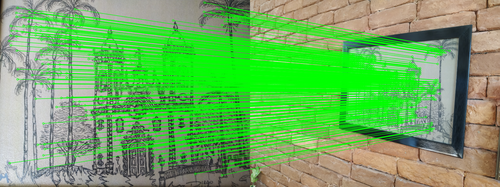

# XFeat: инференс и анализ архитектуры

Анализ модели XFeat (Potje et al., «XFeat: Accelerated Features for Lightweight Image Matching», CVPR 2024). Код модели и предобученные веса принадлежат авторам: [verlab/accelerated_features](https://github.com/verlab/accelerated_features) (Apache 2.0). Здесь они подключены как git submodule без изменений, закреплённые на коммите `e92685f`.

### Структура

| Путь | Содержимое |
|---|---|
| `inference.py` | задание 1: инференс, карта надёжности, матчинг |
| `shapes.py` | задание 2: размеры тензоров по веткам |
| `decisions.py` | задание 3: замеры вычислений, надёжности и refinement |
| `limitations.py` | задание 4: полутоновый вход, поворот, субпиксельная точность |
| `paths.py` | пути к подмодулю и папке результатов |
| `results/` | изображения, полученные `inference.py` |
| `third_party/accelerated_features/` | оригинальный репозиторий XFeat (submodule) |

### Запуск

```bash
git clone --recurse-submodules <url этого репозитория>
cd xfeat-analysis
pip install -r third_party/accelerated_features/requirements.txt
python inference.py      # затем shapes.py, decisions.py, limitations.py
```

Модель: XFeat, предобученные веса `third_party/accelerated_features/weights/xfeat.pt`.
Тестовая пара: `third_party/accelerated_features/assets/ref.png`, `tgt.png` (800×600).

Параметры сети: 1 544 758 всего, из них 657 910 в CNN (backbone и головы) и 886 848 в MLP refinement-модуля (`fine_matcher`).

---

## 1. Инференс на паре изображений

Скрипт: [`inference.py`](inference.py).

### Пайплайн

| Шаг | Вызов | Результат |
|---|---|---|
| Загрузка модели | `XFeat()` | `XFeatModel` с весами `xfeat.pt`, режим `eval` |
| Ключевые точки и дескрипторы (sparse) | `xfeat.detectAndCompute(img, top_k=4096)` | keypoints 4096×2, descriptors 4096×64, scores 4096 |
| Карта надёжности | `xfeat.net(x)` | 1×1×72×100, растянута до 800×600: `stage1_reliability.png`, наложение `stage1_reliability_overlay.png` |
| Матчинг (semi-dense, XFeat*) | `xfeat.match_xfeat_star(ref, tgt, top_k=4096)` | 613 совпадений |
| Фильтрация | `cv2.findHomography(..., USAC_MAGSAC, 3.5)` | 472 инлаера (77%) |

### Предобработка

- `preprocess_tensor` ресайзит изображение до размера, кратного 32: 600×800 → 576×800. Координаты точек потом пересчитываются обратно (`rh = 600/576`, `rw = 1`).
- Сеть сама переводит вход в полутон (`mean` по каналам) и делает InstanceNorm. Поэтому порядок каналов BGR из `cv2.imread` и масштаб 0..255 / 0..1 на результат не влияют.

### Результаты

Совпадения после MAGSAC:



Карта надёжности эталонного изображения. Сеть выдаёт её в разрешении H/8×W/8 = 100×72. Для визуализации она нормирована min-max и билинейно растянута до исходных 800×600. Растяжение корректно, потому что предобработка ресайзит изображение, а не обрезает, и карта покрывает его целиком.


Наложение на изображение (синий цвет — низкая надёжность, красный — высокая):


Высокую надёжность получают текстурированные области с уникальной структурой: окна и проёмы башен, кроны пальм, декор фасада. Низкую — однородный фон (небо, холст) и повторяющиеся узоры (кладка, листва внизу), где дескриптор неоднозначен.

### Замечания

- Sparse-точки (`detectAndCompute`) и матчинг XFeat* — это разные пайплайны. XFeat* не использует keypoint head: точки берутся из сетки ячеек 8×8 и отбираются по карте надёжности. Sparse-матчинг по ключевым точкам выполняет `xfeat.match_xfeat` (взаимный ближайший сосед по дескрипторам).
- В XFeat* refinement уточняет координаты только на первом изображении, точки второго остаются на грубой сетке.
- Score точки в sparse-режиме считается как `keypoint_heatmap × reliability`, затем берётся top-k. В этом прогоне сработало ограничение top-k (ровно 4096 точек).

---

## 2. Размеры тензоров по веткам

Скрипт: [`shapes.py`](shapes.py). На модули вешаются `register_forward_hook`, вход 1×3×576×800.

### Обозначения выходов сети

| В коде | Смысл | Форма |
|---|---|---|
| `M` / `feats` | плотная карта дескрипторов | B×64×H/8×W/8 |
| `K` / `keypoints` | логиты детектора (64 позиции в ячейке 8×8 + dustbin) | B×65×H/8×W/8 |
| `H` / `heatmap` | карта надёжности (sigmoid) | B×1×H/8×W/8 |

### Backbone

| Модуль | Вход | Выход | Масштаб |
|---|---|---|---|
| `block1` | 1×576×800 | 24×144×200 | 1/1 → 1/4 |
| `skip1` (AvgPool4 + conv1×1) | 1×576×800 | 24×144×200 | 1/1 → 1/4 |
| `block2` | 24×144×200 | 24×144×200 | 1/4 |
| `block3` → x3 | 24×144×200 | 64×72×100 | 1/8 |
| `block4` → x4 | 64×72×100 | 64×36×50 | 1/16 |
| `block5` → x5 | 64×36×50 | 64×18×25 | 1/32 |

Ширина каждой стадии (по свёрткам внутри блоков):

| Масштаб | 1/1 | 1/2 | 1/4 | 1/8 | 1/16 | 1/32 |
|---|---|---|---|---|---|---|
| Каналы | 4 | 8 | 24 | 64 | 64 | 128 |

Это совпадает со схемой статьи {4, 8, 24, 64, 64, 128}. На выходе `block5` стоит 1×1-свёртка 128→64: она нужна, чтобы x5 можно было сложить с x3 и x4 в FPN.

### Сверка со статьёй

| Утверждение статьи | Результат | Статус |
|---|---|---|
| Каналы backbone {4, 8, 24, 64, 64, 128} | 4 / 8 / 24 / 64 / 64 / 128 на 1/1 … 1/32 | ✅ |
| Пирамида признаков 1/8 – 1/32 | x3 1/8, x4 1/16, x5 1/32 | ✅ |
| Выход детектора H/8×W/8×65 | 72×100×65 | ✅ |
| Дескрипторы H/8×W/8×64 | 72×100×64 | ✅ |
| Карта надёжности H/8×W/8×1 | 72×100×1 | ✅ |


### Головы

| Ветка | Модуль | Вход | Выход |
|---|---|---|---|
| Descriptor (FPN) | `block_fusion` | x3 + up(x4) + up(x5), 64×72×100 | 64×72×100 |
| Reliability | `heatmap_head` | выход `block_fusion`, 64×72×100 | 1×72×100 |
| Keypoint | `keypoint_head` | unfold 8×8 полутонового изображения, 64×72×100 | 65×72×100 |
| Refinement (XFeat*) | `fine_matcher` | пара дескрипторов, N×128 | N×64 → смещения 8×8 |

- Вход keypoint head по форме совпадает с признаками backbone, но это 64 сырых пикселя каждого патча 8×8 (`_unfold2d(x, ws=8)`). От backbone он не зависит.
- После softmax и depth-to-space (`get_kpts_heatmap`) логиты K превращаются в карту вероятностей полного разрешения 1×576×800.
- Дескрипторы M на выходе сети не нормированы, L2-нормировка делается в `detectAndCompute`.


### Почему H и W должны быть кратны 32

Масштаб уменьшают пять свёрток со stride 2 (две в `block1` и по одной в `block3`, `block4`, `block5`), 2⁵ = 32. Свёртка 3×3 со stride 2 и padding 1 даёт размер `ceil(n/2)`. Проверка на разных высотах:

| H | block1 | skip1 | x3 | x4 | x5 | unfold | Итог |
|---|---|---|---|---|---|---|---|
| 576 (кратно 32) | 144 | 144 | 72 | 36 | 18 | 72 | всё согласовано |
| 600 (кратно 8) | 150 | 150 | 75 | 38 | 19 | 75 | работает, но уровни пирамиды смещены при апсемпле в FPN |
| 590 (кратно 2) | 148 | 147 | — | — | — | — | падение на `x1 + skip1` |

---

## 3. Ключевые архитектурные решения

Скрипт с замерами: [`decisions.py`](decisions.py). Он считает вычисления по стадиям backbone, а также точность матчинга и роль надёжности на паре «изображение → его копия под известной гомографией» (масштаб и перспектива, без поворота). Такая пара даёт точную ground truth для ошибки в пикселях.

Как обучаются ветки (`modules/training/losses.py`, `train.py`):

| Ветка | Функция потерь | Цель |
|---|---|---|
| Дескрипторы M | `dual_softmax_loss` | соответствия MegaDepth и синтетических гомографий на сетке 1/8 |
| Детектор K | `alike_distill_loss` | ключевые точки учителя ALIKE как класс 0..63 внутри ячейки 8×8, остальное — dustbin 64 |
| Надёжность H | `keypoint_loss` (L1) | уверенность dual-softmax `conf` для этой пары (без градиента) |
| Refinement | `coordinate_classification_loss` | класс 0..63 субпиксельного положения в ячейке, взвешенный по `conf` |

### 3.1. Узкие каналы на высоком разрешении вместо глубины

Стоимость свёртки 3×3 пропорциональна `H·W·C_in·C_out`. Значит, на полном разрешении дорог каждый канал, а на 1/32 каналы почти бесплатны: площадь карты там в 1024 раза меньше. XFeat распределяет ширину обратно пропорционально площади.

Вычисления backbone по стадиям (вход 576×800):

| Масштаб | 1/1 | 1/2 | 1/4 | 1/8 | 1/16 | 1/32 | Всего |
|---|---|---|---|---|---|---|---|
| Каналы | 4 | 8 | 24 | 64 | 64 | 128 | |
| GMACs | 0.017 | 0.100 | 0.348 | 0.394 | 0.199 | 0.170 | 1.23 |
| Доля | 1.4% | 8.1% | 28.4% | 32.1% | 16.2% | 13.8% | |

Нагрузка распределена по стадиям почти равномерно, ни одна не доминирует. Для сравнения, одна свёртка 3×3 на полном разрешении стоит:

| Свёртка | GMACs |
|---|---|
| 1 → 4 (как в XFeat) | 0.017 |
| 4 → 64 | 1.06 |
| 64 → 64 (типичный VGG-стем, как в SuperPoint) | 16.99 |

Один слой 64→64 на полном разрешении в 14 раз дороже всего backbone XFeat.

Почему не сделать сеть просто мельче, уменьшив разрешение входа? Для матчинга важна **точная локализация**: каждый уровень stride 2 огрубляет координаты. Поэтому XFeat сохраняет разрешение входа, а экономит на ширине ранних слоёв, где признаки ещё низкоуровневые (градиенты, края) и много каналов им не нужно. Ширину и рецептивное поле (глубину) сеть набирает на 1/8–1/32, где это дёшево. Блок `skip1` (AvgPool 4 + conv 1×1) ещё раз подаёт исходную яркость на 1/4: узкие первые слои теряют информацию, и skip частично её возвращает.

### 3.2. Детектор — отдельная ветка по сырым пикселям (unfold 8×8)

Вход `keypoint_head` — это `_unfold2d(x, ws=8)`: каждый патч 8×8 полутонового изображения разворачивается в 64 канала. Дальше идут только свёртки 1×1, то есть MLP по пикселям одной ячейки. Голова решает, в каком из 64 пикселей ячейки точка, или выбирает dustbin, если точки нет.

Причины такого решения:

1. **Локализация — низкоуровневая задача.** Точное положение угла или блоба определяется пикселями рядом с ним. Глубокие признаки на 1/8 уже размыты пулингом и апсемплом из 1/16 и 1/32 и хуже подходят для попиксельной точности. Unfold сохраняет все 64 пикселя без потерь.
2. **Развязка задач.** Вход головы получен из нормализованного изображения под `torch.no_grad()` и не зависит от backbone. Поэтому градиент детектора в backbone не попадает: backbone целиком учится под дескрипторы (`dual_softmax_loss`) и не идёт на компромисс между «повторяемостью точек» и «различимостью дескрипторов».
3. **Дешевизна.** Свёртки 1×1 на карте 1/8 почти ничего не стоят. Детектор остаётся необязательным: XFeat* его не вызывает.
4. **Обучение через дистилляцию.** Детектор учится повторять точки ALIKE (`alike_distill_loss`), поэтому собственного self-supervised обучения детекции (как в SuperPoint) не нужно.

Компромисс: рецептивное поле детектора — ровно 8×8 пикселей, без контекста. Это ограничение возвращается в разделе 4.

### 3.3. FPN-фьюжн дескрипторов

```
x3 (1/8,  64) ─────────────────────────┐
x4 (1/16, 64) ── bilinear up ×2 ───────┼─ sum ─ block_fusion ─ M (1/8, 64)
x5 (1/32, 64) ── bilinear up ×4 ───────┘
```

- **x3** даёт локальную структуру и точную привязку к ячейке 8×8.
- **x4 и x5** дают контекст: рецептивное поле в десятки пикселей, устойчивость к изменениям масштаба и освещения, различение повторяющихся узоров по окружению.
- Слияние делается **суммой**, а не конкатенацией: число каналов не растёт. Для этого `block5` в конце сжимает 128→64.
- `block_fusion` (две свёртки 3×3 и 1×1) смешивает уровни после суммы.

Итог — один плотный дескриптор на каждую ячейку 1/8, в котором соединены детализация и контекст. Благодаря тому, что карта плотная, работает semi-dense режим (3.5).

### 3.4. Роль карты надёжности

Надёжность H — это предсказание того, **насколько уверенно дескриптор этой ячейки найдёт своё соответствие**. Целевое значение при обучении — уверенность dual-softmax `conf12 · conf21` для правильного соответствия (L1-регрессия). Высокое значение означает уникальный дескриптор, низкое — однородную или повторяющуюся область (см. карту в разделе 1).

Использование:
- **sparse:** `score = keypoint_heatmap × reliability`. Точка должна быть и повторяемой (детектор), и различимой (надёжность).
- **XFeat\*:** надёжность — единственный критерий выбора ячеек для top-k.

Проверка: все 7200 ячеек матчатся без отбора (MNN), результат разбит по квартилям надёжности.

| Квартиль надёжности | Доля ячеек с взаимным совпадением | Точность совпадений (< 8 px) |
|---|---|---|
| Q1 (низкая) | 45.9% | 93.3% |
| Q2 | 66.8% | 99.1% |
| Q3 | 71.1% | 99.6% |
| Q4 (высокая) | 77.6% | 99.7% |

Ячейки с низкой надёжностью реже проходят взаимную проверку и дают в ~20 раз больше ошибок (6.7% против 0.3%). Пара синтетическая и лёгкая (то же изображение), поэтому на реальных парах разница должна быть сильнее.

### 3.5. Semi-dense матчинг (XFeat\*) и refinement

Шаги `match_xfeat_star`:

1. **Плотное извлечение на двух масштабах** (`extract_dualscale`): изображение уменьшается в 0.6 раза и увеличивается в 1.3 раза. В каждой версии каждая ячейка 8×8 — кандидат, кандидаты отбираются по надёжности (20% и 80% от top-k). Точки детектора не нужны, поэтому матчи появляются и на слабых текстурах, где детектор молчит.
2. **MNN** по косинусной близости дескрипторов.
3. **Refinement** (`fine_matcher`): на вход MLP подаётся пара дескрипторов `[d0, d1]` (128), на выходе — 64 логита, то есть распределение по 8×8 положениям в ячейке. `subpix_softmax2d` берёт мат. ожидание и даёт субпиксельный сдвиг. Совпадения с уверенностью ниже 0.25 отбрасываются.

Зачем нужен refinement: координата грубого матча — угол ячейки 8×8, ошибка квантования до 4 px по каждой оси. Refinement возвращает точность без вычисления карт признаков на полном разрешении: модуль работает только с уже найденными парами (N × MLP), а не с каждым пикселем.

Ошибка относительно известной гомографии (ref → warp(ref, H_gt)):

| Метод | Матчей | Медиана, px | < 1 px | < 3 px |
|---|---|---|---|---|
| Sparse (детектор + MNN) | 2703 | 1.06 | 47.2% | 80.0% |
| XFeat\* без refinement (сетка 8×8) | 2688 | 2.37 | 10.4% | 68.1% |
| XFeat\* с refinement | 2688 | 1.10 | 43.3% | 94.6% |

Refinement уменьшает медианную ошибку в 2.2 раза и поднимает долю матчей точнее 1 px с 10% до 43%. В разделе 4.3 показано, что у refinement есть систематическое смещение ~1 px. После его исправления медиана опускается до 0.70 px. После refinement semi-dense матчи сравнимы по точности с sparse-точками детектора, а надёжных (< 3 px) среди них заметно больше.

Особенности реализации:
- Сдвиг применяется только к точкам изображения 0. Точки изображения 1 остаются в углах ячеек.
- Refinement использует **только дескрипторы**, без патчей изображения, поэтому стоит почти ничего, но точность ограничена информацией, которая уместилась в 64-мерный дескриптор.

## 4. Ограничения архитектуры

Скрипт: [`limitations.py`](limitations.py). Все тесты сделаны на синтетических парах с известным преобразованием, поэтому ошибку можно измерить точно.

### 4.1. Полутоновый вход

Первая операция `forward` — `x.mean(dim=1)`: три канала усредняются с равными весами, затем идёт InstanceNorm ([model.py:135-136](third_party/accelerated_features/modules/model.py#L135-L136)). Всё, что различается только цветом, сеть не видит.

Проверки:

| Тест | Результат |
|---|---|
| Перестановка каналов BGR → GBR | относительная разница дескрипторов 3·10⁻⁴ (шум float) |
| Гладкая случайная текстура в **яркости** | 4096 точек, 3685 матчей, 99.1% верных |
| Та же текстура только в **оттенке** (R = 128 + t, G = 128 − t, среднее каналов постоянно) | 11 точек, 6 матчей |

Для сети изображение, где структура закодирована только оттенком, — пустой серый лист. 11 точек появились из-за округления при переводе в uint8, а не из-за цвета.

Последствия:
- Нельзя отличить объекты одинаковой яркости и разного цвета (разметка, знаки, листва на фоне цветов).
- Цвет не используется для разрешения неоднозначностей на повторяющихся структурах.
- Плюсы: вход в 3 раза дешевле на первом слое и устойчив к балансу белого, смене камеры и цветовым сдвигам освещения.

### 4.2. Нет эквивариантности к повороту

Свёртки эквивариантны к сдвигу, но не к повороту. В архитектуре нет механизма, который учитывал бы ориентацию (оценка доминантного направления, как в SIFT/ORB, или steerable-фильтры). Обучающие пары MegaDepth в основном сняты при вертикальной камере, поэтому дескрипторы привязаны к ориентации изображения.

Пара «изображение → оно же, повёрнутое вокруг центра», верный матч — ошибка < 3 px:

| Угол | Sparse: матчей | верных | % | XFeat\*: матчей | верных | % |
|---|---|---|---|---|---|---|
| 0° | 4096 | 4096 | 100.0 | 4092 | 3988 | 97.5 |
| 10° | 2596 | 2012 | 77.5 | 2568 | 2203 | 85.8 |
| 20° | 2401 | 1761 | 73.3 | 2051 | 1528 | 74.5 |
| 30° | 2065 | 1250 | 60.5 | 1409 | 667 | 47.3 |
| 45° | 914 | 78 | 8.5 | 304 | 27 | 8.9 |
| 60° | 807 | 1 | 0.1 | 333 | 0 | 0 |
| 90° | 868 | 0 | 0 | 331 | 0 | 0 |
| 180° | 1027 | 0 | 0 | 425 | 0 | 0 |

До ~30° модель держится: свёртки и аугментации дают некоторую устойчивость к небольшим наклонам. На 45° она практически ломается, а от 60° верных матчей нет совсем. При этом «матчи» продолжают находиться: MNN всегда выдаёт пары, но все они ложные. Без геометрической проверки (RANSAC) это незаметно.

Обходные пути: прогон с поворотами запроса на k·90° с выбором лучшего результата (×4 к стоимости), аугментация поворотами при обучении (ценой части различимости) или оценка ориентации внешним сенсором (IMU).

### 4.3. Нет субпиксельной точности в sparse-режиме без refinement

Ключевые точки sparse-режима берутся из `NMS` по карте детектора как индексы пикселей ([xfeat.py:254](third_party/accelerated_features/modules/xfeat.py#L254)), то есть это целые числа. Уточнения внутри пикселя (soft-argmax, квадратичная интерполяция пика) нет.

Пара «изображение → оно же, сдвинутое на dx пикселей по x» (вход обрезан до 576×800, чтобы не было ресайза координат):

| dx, px | Sparse: медианная ошибка | Sparse: доля целых смещений | XFeat\*: медианная ошибка | XFeat\*: средняя знаковая ошибка (x, y) |
|---|---|---|---|---|
| 0.00 | 0.00 | 100% | 1.18 | (+0.96, +1.05) |
| 0.25 | 0.25 | 100% | 1.21 | (+0.96, +1.04) |
| 0.50 | 0.50 | 100% | 1.21 | (+0.92, +1.04) |
| 0.75 | 0.75 | 100% | 1.15 | (+0.87, +1.04) |

- Максимальное отклонение координат sparse-точек от целого пикселя — ровно 0.
- Ошибка sparse-матчей **равна сдвигу**: точки на сдвинутом изображении остаются в тех же пикселях, и субпиксельный сдвиг детектор не замечает вовсе. Ошибка доходит до 0.75 px, а не до 0.5, как было бы при честном округлении.
- На крупном масштабе это незаметно, но для задач, где нужна точность < 1 px (калибровка, SfM, стереодальнометрия), sparse-режим без уточнения даёт систематическую погрешность.

Refinement-модуль (XFeat\*) решает это только для semi-dense режима: координаты непрерывные. Но в этой реализации у него обнаружилось **систематическое смещение около 1 px**. На идентичной паре (dx = 0) MLP почти всегда выбирает бин (3, 3) из 8×8, а `subpix_softmax2d` отсчитывает сдвиг от центра `W//2 = 4`. «Нулевой» сдвиг превращается в −1 бин (≈ −1 px × масштаб извлечения). Если отсчитывать от 3, ошибка заметно падает:

| Пара | Центр 4 (как в коде) | Центр 3 |
|---|---|---|
| Гомография из раздела 3.5: медиана / < 1 px | 1.10 px / 43% | 0.70 px / 69% |
| Сдвиг dx = 0.5: медиана / < 1 px | 1.21 px / 22% | 0.28 px / 97% |

Это рассогласование соглашения о «нуле» между обучением и инференсом в данной версии кода, а не принципиальное ограничение архитектуры. Вывод сделан на синтетических парах одного изображения. Перед тем как править `subpix_softmax2d`, его стоит проверить на реальном бенчмарке (MegaDepth-1500 через `modules/eval/megadepth1500.py`).

Другие ограничения refinement: сдвиг ограничен одной ячейкой (±4 бина), так что грубую ошибку матча он не исправит. Уточняются только точки изображения 0, а работает модуль только по дескрипторам, без пикселей.

### Итог

| Ограничение | Причина в архитектуре | Измеренный эффект |
|---|---|---|
| Полутоновый вход | `mean` по каналам перед сетью | текстура только в оттенке: 4096 → 11 точек |
| Нет эквивариантности к повороту | обычные свёртки, нет оценки ориентации | верных матчей 100% → 8.5% на 45°, 0% от 60° |
| Нет субпикселя в sparse | NMS возвращает целые индексы | ошибка = субпиксельному сдвигу (до 0.75 px) |
| Смещение refinement (находка) | центр бинов 4 при обученном нуле в бине 3 | медиана 1.10 → 0.70 px после сдвига центра |


