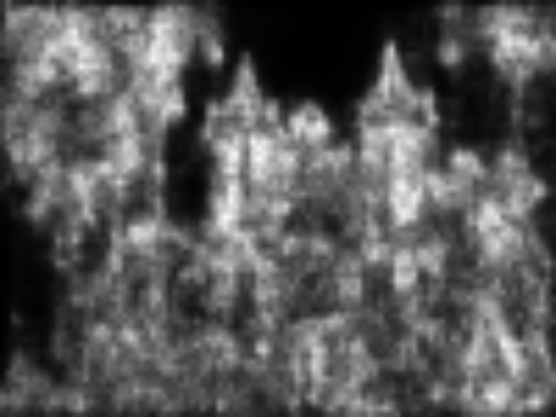
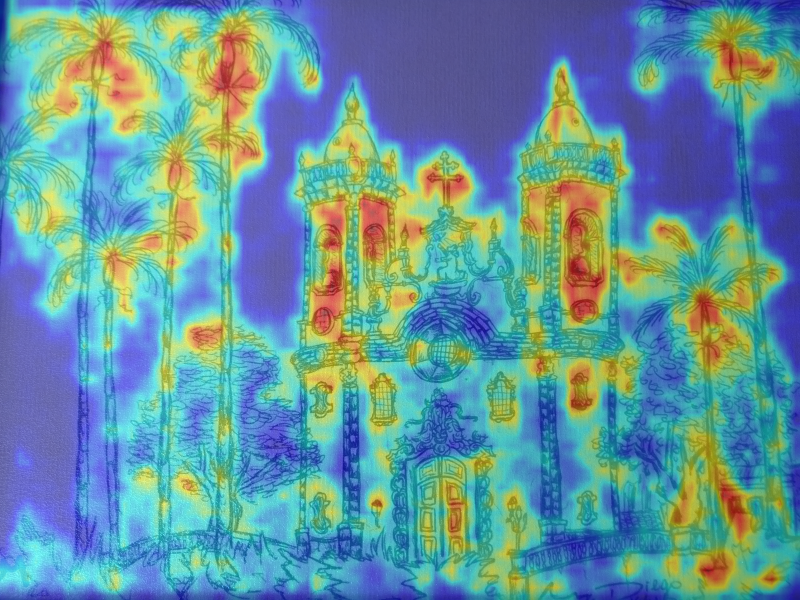
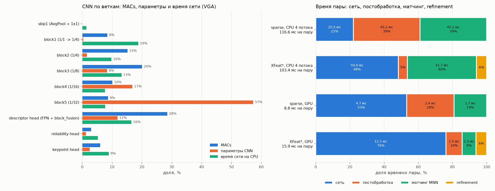
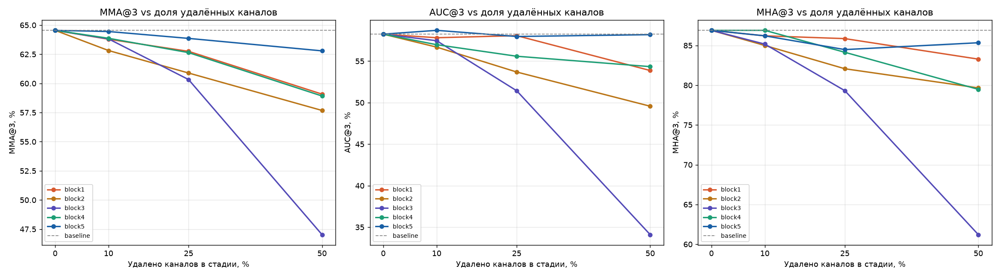
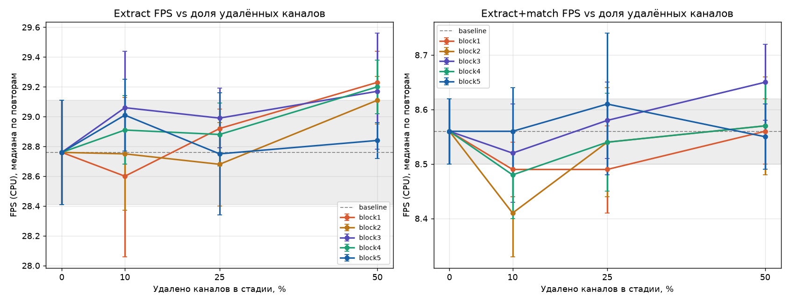
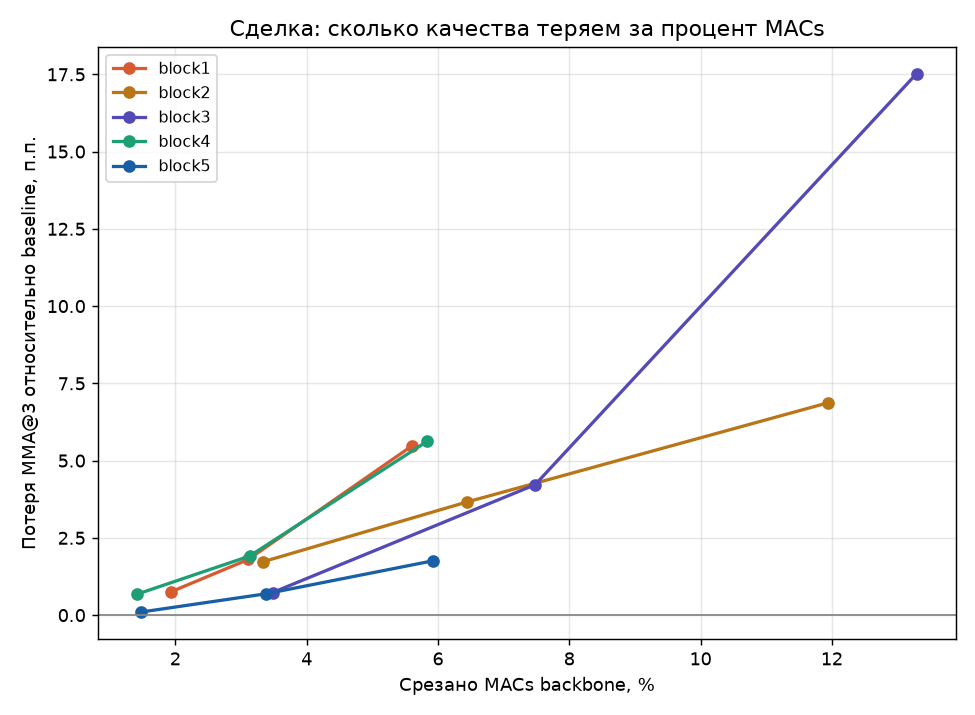

# XFeat: разбор архитектуры, оценка на HPatches и структурный прунинг

Анализ модели XFeat (Potje et al., «XFeat: Accelerated Features for Lightweight Image Matching», CVPR 2024). Код модели и предобученные веса принадлежат авторам: [verlab/accelerated_features](https://github.com/verlab/accelerated_features) (Apache 2.0). Здесь они подключены как git submodule без изменений.

Отчёт состоит из четырёх частей:

- **Часть I.** Разбор архитектуры XFeat: инференс, размеры тензоров по веткам, ключевые решения, ограничения.
- **Часть II.** Оценка предобученной модели на бенчмарке HPatches и замер скорости на CPU и GPU, сравнение с числами статьи.
- **Часть III.** Профиль вычислений: MACs и параметры по веткам, распределение времени пары, вклад матчинга и refinement, количественный потолок прунинга.
- **Часть IV.** Структурный прунинг backbone: можно ли ускорить или облегчить сеть и где у метода потолок.

---

## Структура проекта

| Путь | Содержимое |
|---|---|
| `analysis/inference.py` | инференс, карта надёжности, матчинг |
| `analysis/shapes.py` | размеры тензоров по веткам |
| `analysis/decisions.py` | замеры вычислений, надёжности и refinement |
| `analysis/limitations.py` | полутоновый вход, поворот, субпиксельная точность |
| `analysis/profile.py` | MACs и параметры по веткам, время пары по шагам на CPU и GPU, потолок прунинга |
| `benchmark/hpatches_check.py` | проверка структуры HPatches |
| `benchmark/hpatches_eval.py` | MMA, AUC, MHA на HPatches |
| `benchmark/speed_benchmark.py` | скорость extract / match / пара |
| `prune/prune_xfeat.py` | структурный L1-прунинг одной стадии backbone |
| `prune/prune_sweep_macs.py` | снижение MACs при прунинге каждой стадии по отдельности |
| `prune/prune_grid_eval.py` | полная сетка прунинга: качество и скорость |
| `prune/prune_criteria_compare.py` | сравнение критериев важности L1 / L2 / случайный |
| `prune/prune_sensitivity.py` | профиль чувствительности по стадиям |
| `prune/prune_nonuniform.py` | неравномерная резка всех стадий за один проход |
| `prune/speed_breakdown.py` | разбивка времени пары на CPU (сеть / извлечение / матчинг) и профиль извлечения |
| `prune/plot_prune_curves.py` | построение кривых из CSV |
| `common/paths.py` | пути к подмодулю и папке результатов |
| `results/` | изображения `inference.py` и JSON с результатами замеров |
| `third_party/accelerated_features/` | оригинальный репозиторий XFeat (submodule) |

### Запуск

```bash
git clone --recurse-submodules git@github.com:Alessandra-m/XFeat-analysis.git
cd XFeat-analysis
pip install -r third_party/accelerated_features/requirements.txt
# из корня как модуль (python -m <папка>.<скрипт>) или напрямую: python prune/prune_xfeat.py ...
python -m analysis.inference      # затем analysis.shapes, analysis.decisions, analysis.limitations
python -m benchmark.hpatches_eval --matcher xfeat --subset all --resize 480 --seeds 0 1 2 3 4
python -m prune.prune_grid_eval --device cuda
```

Модель: XFeat, предобученные веса `third_party/accelerated_features/weights/xfeat.pt`. Тестовая пара: `third_party/accelerated_features/assets/ref.png`, `tgt.png` (800×600).

Параметры сети: 1 544 758 всего, из них 657 910 в CNN (backbone и головы) и 886 848 в MLP refinement-модуля (`fine_matcher`).

## Окружение и целевой компьютер

| Параметр | Значение |
|---|---|
| CPU | AMD Ryzen 5 5600 (6 ядер, 12 потоков) |
| GPU | NVIDIA GeForce RTX 3050 (CUDA 13.0) |
| ОС | Linux (glibc 2.43) |
| Python | 3.14.4 |
| PyTorch | 2.14.1+cu130 |
| OpenCV | 5.0.0 |
| NumPy | 2.5.2 |

## Навигация

**[Часть I. Разбор архитектуры XFeat](#p1)**
- [1. Инференс на паре изображений](#p1-s1)
- [2. Размеры тензоров по веткам](#p1-s2)
- [3. Ключевые архитектурные решения](#p1-s3)
- [4. Ограничения архитектуры](#p1-s4)

**[Часть II. Оценка на HPatches и скорость](#p2)**
- [1. Подготовка HPatches и протокол оценки](#p2-s1)
- [2. Метрики предобученной XFeat (sparse)](#p2-s2)
- [3. Скорость инференса](#p2-s3)
- [4. Сравнение с числами авторов](#p2-s4)

**[Часть III. Профиль вычислений и потолок прунинга](#p3)**
- [1. MACs и параметры по веткам](#p3-s1)
- [2. Распределение затрат](#p3-s2)
- [3. Вклад матчинга и refinement на CPU](#p3-s3)
- [4. Где прунинг даёт выигрыш и где потолок](#p3-s4)

**[Часть IV. Структурный прунинг backbone](#p4)**
- [Краткий итог](#p4-s0)
- [1. Скрипт прунинга и обработка зависимостей](#p4-s1)
- [2. Сетка уровней и метрики](#p4-s2)
- [3. Кривые](#p4-s3)
- [4. Ранние узкие стадии](#p4-s4)
- [5. Конфигурации на дообучение](#p4-s5)
- [6. Сравнение критериев важности](#p4-s6)
- [7. Профиль чувствительности и неравномерная резка](#p4-s7)
- [Итог по блоку](#p4-end)

---

<a id="p1"></a>
# Часть I. Разбор архитектуры XFeat

<a id="p1-s1"></a>
## 1. Инференс на паре изображений

Скрипт: [`inference.py`](analysis/inference.py).

### Пайплайн

| Шаг | Вызов | Результат |
|---|---|---|
| Загрузка модели | `XFeat()` | `XFeatModel` с весами `xfeat.pt`, режим `eval` |
| Ключевые точки и дескрипторы (sparse) | `xfeat.detectAndCompute(img, top_k=4096)` | keypoints 4096×2, descriptors 4096×64, scores 4096 |
| Карта надёжности | `xfeat.net(x)` | 1×1×72×100, растянута до 800×600: `inference_reliability.png`, наложение `inference_reliability_overlay.png` |
| Матчинг (semi-dense, XFeat*) | `xfeat.match_xfeat_star(ref, tgt, top_k=4096)` | 613 совпадений |
| Фильтрация | `cv2.findHomography(..., USAC_MAGSAC, 3.5)` | 472 инлаера (77%) |

### Предобработка

- `preprocess_tensor` ресайзит изображение до размера, кратного 32: 600×800 → 576×800. Координаты точек потом пересчитываются обратно (`rh = 600/576`, `rw = 1`).
- Сеть сама переводит вход в полутон (`mean` по каналам) и делает InstanceNorm. Поэтому порядок каналов BGR из `cv2.imread` и масштаб 0..255 / 0..1 на результат не влияют.

### Результаты

Совпадения после MAGSAC:


Карта надёжности эталонного изображения. Сеть выдаёт её в разрешении H/8×W/8 = 72×100. Для визуализации она нормирована min-max и билинейно растянута до исходных 800×600. Растяжение корректно, потому что предобработка ресайзит изображение, а не обрезает, и карта покрывает его целиком.



Наложение на изображение (синий цвет означает низкую надёжность, красный высокую):



Высокую надёжность получают текстурированные области с уникальной структурой: окна и проёмы башен, кроны пальм, декор фасада. Низкую получают однородный фон (небо, холст) и повторяющиеся узоры (кладка, листва внизу), где дескриптор неоднозначен.

<a id="p1-s2"></a>
## 2. Размеры тензоров по веткам

Скрипт: [`shapes.py`](analysis/shapes.py). На модули вешаются `register_forward_hook`, вход 1×3×576×800.

### Обозначения выходов сети

| В коде | Смысл | Форма |
|---|---|---|
| `M` / `feats` | плотная карта дескрипторов | B×64×H/8×W/8 |
| `K` / `keypoints` | логиты детектора (64 позиции в ячейке 8×8 + dustbin) | B×65×H/8×W/8 |
| `H` / `heatmap` | карта надёжности (reliability, sigmoid) | B×1×H/8×W/8 |

Чтобы не путать два разных объекта: «reliability», это выход сети `H` (sigmoid, какому дескриптору доверять). «Keypoint heatmap», это результат `get_kpts_heatmap(K)`: softmax по логитам детектора с выбросом dustbin. Ниже «карта надёжности» всегда означает `H`, а карту из `K` называем именно «keypoint heatmap».

### Backbone

| Модуль | Вход | Выход | Масштаб |
|---|---|---|---|
| `block1` | 1×576×800 | 24×144×200 | 1/1 → 1/4 |
| `skip1` (AvgPool4 + conv1×1) | 1×576×800 | 24×144×200 | 1/1 → 1/4 |
| `block2` | 24×144×200 | 24×144×200 | 1/4 |
| `block3` → x3 | 24×144×200 | 64×72×100 | 1/8 |
| `block4` → x4 | 64×72×100 | 64×36×50 | 1/16 |
| `block5` → x5 | 64×36×50 | 64×18×25 | 1/32 |

Ширина каждой стадии (по свёрткам внутри блоков):

| Масштаб | 1/1 | 1/2 | 1/4 | 1/8 | 1/16 | 1/32 |
|---|---|---|---|---|---|---|
| Каналы | 4 | 8 | 24 | 64 | 64 | 128 |

Это совпадает со схемой статьи {4, 8, 24, 64, 64, 128}. На выходе `block5` стоит 1×1-свёртка 128→64: она нужна, чтобы x5 можно было сложить с x3 и x4 в FPN.

### Сверка со статьёй

| Утверждение статьи | Результат | Статус |
|---|---|---|
| Каналы backbone {4, 8, 24, 64, 64, 128} | 4 / 8 / 24 / 64 / 64 / 128 на 1/1 … 1/32 | ✅ |
| Пирамида признаков 1/8 – 1/32 | x3 1/8, x4 1/16, x5 1/32 | ✅ |
| Выход детектора H/8×W/8×65 | 72×100×65 | ✅ |
| Дескрипторы H/8×W/8×64 | 72×100×64 | ✅ |
| Карта надёжности H/8×W/8×1 | 72×100×1 | ✅ |

### Головы

| Ветка | Модуль | Вход | Выход |
|---|---|---|---|
| Descriptor (FPN) | `block_fusion` | x3 + up(x4) + up(x5), 64×72×100 | 64×72×100 |
| Reliability | `heatmap_head` | выход `block_fusion` (дескрипторы M), 64×72×100 | 1×72×100 |
| Keypoint | `keypoint_head` | `_unfold2d(x, 8)` — 64 сырых пикселя патча, **НЕ выход backbone**, 64×72×100 | 65×72×100 |
| Refinement (XFeat*) | `fine_matcher` | пара дескрипторов, N×128 | N×64 → смещения 8×8 |

Формы входов reliability и keypoint совпадают (64×72×100), но это разные тензоры. Reliability-голова, это надстройка над картой дескрипторов (`heatmap_head(feats)`), то есть она **висит на backbone**. Keypoint-голова получает `_unfold2d(x, 8)`, развёртку сырого полутонового изображения, и от backbone не зависит вовсе. Из трёх голов по-настоящему отцеплена от тела только одна, keypoint.

В прогоне `shapes.py` N = 4095, а не 4096. `extract_dualscale` берёт `int(0.2·top_k) + int(0.8·top_k)` = 819 + 3276 = 4095 ячеек: одна теряется при округлении. В примере изображение матчится само с собой, поэтому все 4095 ячеек получают пару.

- После softmax и depth-to-space (`get_kpts_heatmap`) логиты K превращаются в карту вероятностей полного разрешения 1×576×800.
- Дескрипторы M на выходе сети не нормированы, L2-нормировка делается в `detectAndCompute`.

### Почему H и W должны быть кратны 32

Масштаб уменьшают пять свёрток со stride 2 (две в `block1` и по одной в `block3`, `block4`, `block5`), 2⁵ = 32. Свёртка 3×3 со stride 2 и padding 1 даёт размер `ceil(n/2)`. Проверка на разных высотах:

| H | block1 | skip1 | x3 | x4 | x5 | unfold | Итог |
|---|---|---|---|---|---|---|---|
| 576 (кратно 32) | 144 | 144 | 72 | 36 | 18 | 72 | всё согласовано |
| 600 (кратно 8) | 150 | 150 | 75 | 38 | 19 | 75 | работает, но уровни пирамиды смещены при апсемпле в FPN |
| 590 (кратно 2) | 148 | 147 | — | — | — | — | падение на `x1 + skip1` |

<a id="p1-s3"></a>
## 3. Ключевые архитектурные решения

Скрипт с замерами: [`decisions.py`](analysis/decisions.py). Он считает вычисления по стадиям backbone, а также точность матчинга и роль надёжности на паре «изображение → его копия под известной гомографией» (масштаб и перспектива, без поворота). Такая пара даёт точную ground truth для ошибки в пикселях.

Как обучаются ветки (`modules/training/losses.py`, `train.py`):

| Ветка | Функция потерь | Цель |
|---|---|---|
| Дескрипторы M | `dual_softmax_loss` | соответствия MegaDepth и синтетических гомографий на сетке 1/8 |
| Детектор K | `alike_distill_loss` | ключевые точки учителя ALIKE как класс 0..63 внутри ячейки 8×8, остальное — dustbin 64 |
| Надёжность H | `keypoint_loss` (L1) | регрессия в таргет `conf = conf12·conf21` dual-softmax; таргет детачится (`torch.no_grad`), но предсказание `heatmap_head(feats)` — нет, поэтому градиент идёт в backbone |
| Refinement | `coordinate_classification_loss` | класс 0..63 субпиксельного положения в ячейке, взвешенный по `conf` |

### 3.1. Узкие каналы на высоком разрешении вместо глубины

Стоимость свёртки 3×3 пропорциональна `H·W·C_in·C_out`. Значит, на полном разрешении дорог каждый канал, а на 1/32 каналы почти бесплатны: площадь карты там в 1024 раза меньше. XFeat наращивает ширину по мере уменьшения площади карты: площадь от 1/1 до 1/32 падает в 1024 раза, а число каналов растёт только в 32 раза (4 → 128).

Вычисления backbone по стадиям (вход 576×800):

| Масштаб | 1/1 | 1/2 | 1/4 | 1/8 | 1/16 | 1/32 | Всего |
|---|---|---|---|---|---|---|---|
| Каналы | 4 | 8 | 24 | 64 | 64 | 128 | |
| GMACs | 0.017 | 0.100 | 0.348 | 0.394 | 0.199 | 0.170 | 1.23 |
| Доля | 1.4% | 8.1% | 28.4% | 32.1% | 16.2% | 13.8% | |

Ни одна стадия не доминирует: самая дорогая (1/8) занимает около трети, а полное разрешение, всего 1.4%. Для сравнения, одна свёртка 3×3 на полном разрешении стоит:

| Свёртка | GMACs |
|---|---|
| 1 → 4 (как в XFeat) | 0.017 |
| 4 → 64 | 1.06 |
| 64 → 64 (типичный VGG-стем, как в SuperPoint) | 16.99 |

Один слой 64→64 на полном разрешении в 14 раз дороже всего backbone XFeat.

Почему не сделать сеть просто мельче, уменьшив разрешение входа? Для матчинга важна **точная локализация**: каждый уровень stride 2 огрубляет координаты. Поэтому XFeat сохраняет разрешение входа, а экономит на ширине ранних слоёв, где признаки ещё низкоуровневые (градиенты, края) и много каналов им не нужно. Ширину и рецептивное поле (глубину) сеть набирает на 1/8–1/32, где это дёшево. Блок `skip1` (AvgPool 4 + conv 1×1) ещё раз подаёт исходную яркость на 1/4: узкие первые слои теряют информацию, и skip частично её возвращает.

### 3.2. Детектор, отдельная ветка по сырым пикселям (unfold 8×8)

Вход `keypoint_head`, это `_unfold2d(x, ws=8)`: каждый патч 8×8 полутонового изображения разворачивается в 64 канала. Дальше идут только свёртки 1×1, то есть MLP по пикселям одной ячейки. Голова решает, в каком из 64 пикселей ячейки точка, или выбирает dustbin, если точки нет.

Причины такого решения:

1. **Локализация, низкоуровневая задача.** Точное положение угла или блоба определяется пикселями рядом с ним. Глубокие признаки на 1/8 уже огрублены свёртками со stride 2 и апсемплом из 1/16 и 1/32 и хуже подходят для попиксельной точности. Unfold сохраняет все 64 пикселя без потерь.
2. **Развязка детектора от backbone.** Вход головы получен из нормализованного изображения под `torch.no_grad()` (`_unfold2d(x, 8)`) и не зависит от backbone. Поэтому градиент детектора (`alike_distill_loss`) в backbone **не попадает**: тело не идёт на компромисс между «повторяемостью точек» и «различимостью дескрипторов».

   Важное уточнение: это НЕ значит, что «backbone учится только под дескрипторы». По коду обучения (`modules/training/train.py`) backbone формируют **три** лосса, читающие `feats`:
   - `dual_softmax_loss(m1, m2)`, основной, по дескрипторам;
   - `coordinate_classification_loss`, через `fine_matcher(feats)` (refinement);
   - `keypoint_loss(h1, conf)`, reliability: `h1 = heatmap_head(feats)` берётся **без** `.detach()` на `feats`, поэтому градиент идёт `L1 → sigmoid(R) → heatmap_head → feats → backbone`. Детачится только таргет `conf` (он считается внутри `with torch.no_grad()` в `dual_softmax_loss`), это и есть смысл фразы статьи «для L_rel градиент идёт только через R».

   Итог: от backbone отцеплена одна ветка, keypoint-детектор. Reliability, надстройка над дескрипторами и через `feats` тоже влияет на backbone. Четыре лосса усредняются с множителями (×3 у reliability, ×2 у refinement и детектора), но их относительный вклад в градиент backbone не измерялся.
3. **Дешевизна.** Свёртки 1×1 на карте 1/8 почти ничего не стоят. Детектор остаётся необязательным: в XFeat* голова вычисляется при каждом `forward`, но её выход не используется.
4. **Обучение через дистилляцию.** Детектор учится повторять точки ALIKE (`alike_distill_loss`), поэтому собственного self-supervised обучения детекции (как в SuperPoint) не нужно.

### 3.3. FPN-фьюжн дескрипторов

```
x3 (1/8,  64) ─────────────────────────┐
x4 (1/16, 64) ── bilinear up ×2 ───────┼─ sum ─ block_fusion ─ M (1/8, 64)
x5 (1/32, 64) ── bilinear up ×4 ───────┘
```

- **x3** даёт локальную структуру и точную привязку к ячейке 8×8.
- **x4 и x5** дают контекст: рецептивное поле в десятки пикселей, устойчивость к изменениям масштаба и освещения, различение повторяющихся узоров по окружению.
- Слияние делается **суммой**, а не конкатенацией: число каналов не растёт. Для этого `block5` в конце сжимает 128→64.
- `block_fusion` (две свёртки 3×3 и 1×1) смешивает уровни после суммы.

Итог, один плотный дескриптор на каждую ячейку 1/8, в котором соединены детализация и контекст. Благодаря тому, что карта плотная, работает semi-dense режим (3.5).

### 3.4. Роль карты надёжности

Надёжность H, это предсказание того, **насколько уверенно дескриптор этой ячейки найдёт своё соответствие**. Целевое значение при обучении, уверенность dual-softmax `conf12 · conf21` для правильного соответствия (L1-регрессия). Высокое значение означает уникальный дескриптор, низкое, однородную или повторяющуюся область (см. карту в разделе 1).

Использование:
- **sparse:** `score = keypoint_heatmap × reliability`. Точка должна быть и повторяемой (детектор), и различимой (надёжность).
- **XFeat\*:** надёжность, единственный критерий выбора ячеек для top-k.

Проверка: все 7200 ячеек матчатся без отбора (MNN), получается 4705 взаимных совпадений. Ячейки разбиты на квартили надёжности, границы квартилей посчитаны по всем ячейкам и одинаковы для обеих колонок.

| Квартиль | Надёжность | Доля ячеек с взаимным совпадением | Матчей | Точность совпадений (< 8 px) |
|---|---|---|---|---|
| Q1 (низкая) | 0.001–0.168 | 45.9% | 826 | 90.9% |
| Q2 | 0.168–0.295 | 66.8% | 1203 | 98.9% |
| Q3 | 0.295–0.423 | 71.1% | 1280 | 99.7% |
| Q4 (высокая) | 0.423–0.853 | 77.6% | 1396 | 99.6% |

Надёжность действительно предсказывает, сматчится ли ячейка: доля ячеек с взаимным совпадением растёт от 46% в нижнем квартиле до 78% в верхнем, а точность, от 90.9% до 99.6%. Из ~98 ошибочных матчей около 75 (три четверти) приходятся на нижний квартиль. Поэтому отбор точек по надёжности (sparse: в произведении с детектором, XFeat\*: напрямую) отсекает в первую очередь ненадёжные совпадения.

### 3.5. Semi-dense матчинг (XFeat\*) и refinement

Шаги `match_xfeat_star`:

1. **Плотное извлечение на двух масштабах** (`extract_dualscale`): изображение уменьшается в 0.6 раза и увеличивается в 1.3 раза. В каждой версии каждая ячейка 8×8, кандидат, кандидаты отбираются по надёжности (20% и 80% от top-k). Точки детектора не нужны, поэтому матчи появляются и на слабых текстурах, где детектор молчит.
2. **MNN** (`batch_match`) по скалярному произведению дескрипторов, с `min_cossim = -1` (порог по косинусу выключен). В отличие от sparse-режима, дескрипторы здесь **не L2-нормированы** (в `extractDense` нет `F.normalize`, в `detectAndCompute`, есть): их нормы на тестовом изображении от 13.6 до 16.9. Поэтому `d0·d1` близко к косинусной близости, но не равно ей. (Для сравнения: несмежный метод `match()` для sparse использует порог по умолчанию `min_cossim = 0.82`, а `match_xfeat` вызывает его с `-1`.)
3. **Refinement** (`fine_matcher`): на вход MLP подаётся пара дескрипторов `[d0, d1]` (128), на выходе, 64 логита, то есть распределение по 8×8 положениям в ячейке. `subpix_softmax2d` берёт мат. ожидание и даёт субпиксельный сдвиг. Совпадения с уверенностью ниже `fine_conf = 0.25` отбрасываются (константа в `refine_matches`, `xfeat.py`). В статье для порога уверенности приводится 0.2, а документация API `match_xfeat_star` упоминает `min_conf = 0.1` для LighterGlue, это разные пороги; здесь измерен именно `fine_conf` semi-dense refinement.

Зачем нужен refinement: координата грубого матча, левый верхний угол ячейки 8×8 (`create_xy * 8`), поэтому ошибка квантования доходит до целой ячейки по каждой оси: 8 px × масштаб извлечения, то есть ≈ 6 px на масштабе 1.3 и ≈ 13 px на масштабе 0.6 в координатах исходного изображения. Refinement возвращает точность без вычисления карт признаков на полном разрешении: модуль работает только с уже найденными парами (N × MLP), а не с каждым пикселем.

Ошибка относительно известной гомографии (ref → warp(ref, H_gt)):

| Метод | Матчей | Медиана, px | < 1 px | < 3 px |
|---|---|---|---|---|
| Sparse (детектор + MNN) | 2703 | 1.06 | 47.2% | 80.0% |
| XFeat\* без refinement (сетка 8×8) | 2688 | 2.37 | 10.4% | 68.1% |
| XFeat\* с refinement | 2688 | 1.10 | 43.3% | 94.6% |

Здесь ошибка измерена на изображении 1: `H_gt` применяется к точке изображения 0 и сравнивается с точкой изображения 1. Refinement сдвигает только точки изображения 0, поэтому скрипт дополнительно считает ошибку на изображении 0 через `H_gt⁻¹` (строка `error measured in image 0`). Медиана там 2.61 px без refinement и 1.19 px с ним, вывод тот же.

Refinement уменьшает медианную ошибку в 2.2 раза и поднимает долю матчей точнее 1 px с 10% до 43%. В разделе 4.3 показано, что у refinement есть систематическое смещение ~1 px. После его исправления медиана опускается до 0.70 px. После refinement semi-dense матчи сравнимы по точности с sparse-точками детектора, а надёжных (< 3 px) среди них заметно больше.

Особенности реализации:
- Сдвиг применяется только к точкам изображения 0. Точки изображения 1 остаются в углах ячеек.
- Refinement использует **только дескрипторы**, без патчей изображения, поэтому стоит почти ничего, но точность ограничена информацией, которая уместилась в 64-мерный дескриптор.

<a id="p1-s4"></a>
## 4. Ограничения архитектуры

Скрипт: [`limitations.py`](analysis/limitations.py). Все тесты сделаны на синтетических парах с известным преобразованием, поэтому ошибку можно измерить точно.

### 4.1. Полутоновый вход

Первая операция `forward`, `x.mean(dim=1)`: три канала усредняются с равными весами, затем идёт InstanceNorm ([model.py:135-136](third_party/accelerated_features/modules/model.py#L135-L136)). Всё, что различается только цветом, сеть не видит.

Проверки:

| Тест | Результат |
|---|---|
| Перестановка каналов BGR → GBR | относительная разница дескрипторов 3·10⁻⁴ (шум float) |
| Гладкая случайная текстура в **яркости** | 4096 точек, 3685 матчей, 99.1% верных |
| Та же текстура только в **оттенке** (R = 128 + t, G = 128 − t, среднее каналов постоянно) | 11 точек, 6 матчей |

Для сети изображение, где структура закодирована только оттенком, пустой серый лист. 11 точек появились из-за округления при переводе в uint8, а не из-за цвета.

Последствия:
- Нельзя отличить объекты одинаковой яркости и разного цвета (разметка, знаки, листва на фоне цветов).
- Цвет не используется для разрешения неоднозначностей на повторяющихся структурах.
- Плюсы: вход в 3 раза дешевле на первом слое и устойчив к балансу белого, смене камеры и цветовым сдвигам освещения.

### 4.2. Нет эквивариантности к повороту

Свёртки эквивариантны к сдвигу, но не к повороту. В архитектуре нет механизма, который учитывал бы ориентацию (оценка доминантного направления, как в SIFT/ORB, или steerable-фильтры). Обучающие пары MegaDepth в основном сняты при вертикальной камере. Синтетические пары при обучении поворачиваются только на случайный угол в пределах ±30° (`generateRandomHomography`, [augmentation.py:56](third_party/accelerated_features/modules/dataset/augmentation.py#L56)). Поэтому дескрипторы привязаны к ориентации изображения.

Пара «изображение → оно же, повёрнутое вокруг центра», верный матч, ошибка < 3 px:

| Угол | Sparse: матчей | верных | % | XFeat\*: матчей | верных | % |
|---|---|---|---|---|---|---|
| 0° | 4096 | 4096 | 100.0 | 4092 | 3988 | 97.5 |
| 10° | 2596 | 2012 | 77.5 | 2568 | 2203 | 85.8 |
| 20° | 2401 | 1761 | 73.3 | 2051 | 1528 | 74.5 |
| 30° | 2065 | 1250 | 60.5 | 1409 | 667 | 47.3 |
| 45° | 914 | 78 | 8.5 | 304 | 27 | 8.9 |
| 60° | 807 | 1 | 0.1 | 333 | 0 | 0 |
| 90° | 868 | 0 | 0 | 331 | 0 | 0 |
| 180° | 1027 | 0 | 0 | 425 | 0 | 0 |

До ~30° модель держится: это ровно диапазон поворотов, который она видела при обучении. На 45° она практически ломается, а от 60° верных матчей практически нет (у sparse один из 807 на 60°, дальше ноль). При этом «матчи» продолжают находиться: MNN всегда выдаёт пары, но все они ложные. Без геометрической проверки (RANSAC) это незаметно.

Обходные пути: прогон с поворотами запроса на k·90° с выбором лучшего результата (×4 к стоимости), аугментация на более широкий диапазон углов, чем нынешние ±30° (ценой части различимости) или оценка ориентации внешним сенсором (IMU).

### 4.3. Нет субпиксельной точности в sparse-режиме без refinement

Ключевые точки sparse-режима берутся из `NMS` по карте детектора как индексы пикселей ([xfeat.py:254](third_party/accelerated_features/modules/xfeat.py#L254)), то есть это целые числа. Уточнения внутри пикселя (soft-argmax, квадратичная интерполяция пика) нет.

Пара «изображение → оно же, сдвинутое на dx пикселей по x» (вход обрезан до 576×800, чтобы не было ресайза координат):

| dx, px | Sparse: медианная ошибка | Sparse: доля целых смещений | XFeat\*: медианная ошибка | XFeat\*: средняя знаковая ошибка (x, y) |
|---|---|---|---|---|
| 0.00 | 0.00 | 100% | 1.18 | (+0.96, +1.05) |
| 0.25 | 0.25 | 100% | 1.21 | (+0.96, +1.04) |
| 0.50 | 0.50 | 100% | 1.21 | (+0.92, +1.04) |
| 0.75 | 0.75 | 100% | 1.15 | (+0.87, +1.04) |

- Максимальное отклонение координат sparse-точек от целого пикселя, ровно 0.
- Ошибка sparse-матчей **равна сдвигу**: точки на сдвинутом изображении остаются в тех же пикселях, и субпиксельный сдвиг детектор не замечает вовсе. Ошибка доходит до 0.75 px, а не до 0.5, как было бы при честном округлении.
- На крупном масштабе это незаметно, но для задач, где нужна точность < 1 px (калибровка, SfM, стереодальнометрия), sparse-режим без уточнения даёт систематическую погрешность.

Refinement-модуль (XFeat\*) решает это только для semi-dense режима: координаты непрерывные. Но в этой реализации у него обнаружилось **систематическое смещение около 1 px**. На идентичной паре (dx = 0) MLP выбирает бин (3, 3) из 8×8 в 86% случаев и (3, 2) в 11%. При этом `subpix_softmax2d` отсчитывает сдвиг от центра `W//2 = 4` ([xfeat.py:296-297](third_party/accelerated_features/modules/xfeat.py#L296-L297)). «Нулевой» сдвиг превращается в −1 бин (≈ −1 px × масштаб извлечения). Средняя знаковая ошибка ≈ +0.96 px из таблицы выше с этим согласуется: 0.2 · 1/0.6 + 0.8 · 1/1.3 ≈ 0.95. Если отсчитывать от 3, ошибка заметно падает (раздел 4 вывода `limitations.py`):

| Пара | Центр 4 (как в коде) | Центр 3 |
|---|---|---|
| Гомография из раздела 3.5: медиана / < 1 px | 1.10 px / 43% | 0.70 px / 69% |
| Сдвиг dx = 0.5: медиана / < 1 px | 1.21 px / 22% | 0.28 px / 97% |
| Идентичная пара: медиана / < 1 px | 1.18 px / 14% | 0.20 px / 98% |

Это рассогласование соглашения о «нуле» в данной версии кода, а не принципиальное ограничение архитектуры. Утверждать, что это ошибка в коде, нельзя. В опубликованном коде обучения метка строится так (`coordinate_classification_loss`, `losses.py`): `offset = (pts·8)/8 − floor(...)`, затем `labels = offset_x + 8·offset_y`, то есть смещение отсчитывается **от угла ячейки**, и нулевому сдвигу соответствует бин (0, 0). А инференс (`subpix_softmax2d`) вычитает центр `W//2 = 4`, то есть считает нулём бин (4, 4). Опубликованные веса на практике дают пик в (3, 3). Значит, веса обучались с другим соглашением, чем в выложенном `train.py`, и какое из соглашений авторы считают правильным, по репозиторию не установить. Если числа в статье получены этим же кодом инференса, смещение в них уже учтено. По репозиторию это проверить нельзя. Вывод сделан на синтетических парах одного изображения. Перед тем как править `subpix_softmax2d`, его стоит проверить на реальном бенчмарке (MegaDepth-1500 через `modules/eval/megadepth1500.py`).

Другие ограничения refinement: сдвиг ограничен одной ячейкой (±4 бина), так что грубую ошибку матча он не исправит. Уточняются только точки изображения 0, а работает модуль только по дескрипторам, без пикселей.

### Итог части I

| Ограничение | Причина в архитектуре | Измеренный эффект |
|---|---|---|
| Полутоновый вход | `mean` по каналам перед сетью | текстура только в оттенке: 4096 → 11 точек |
| Нет эквивариантности к повороту | обычные свёртки, нет оценки ориентации | верных матчей 100% → 8.5% на 45°, ≈0% от 60° |
| Нет субпикселя в sparse | NMS возвращает целые индексы | ошибка = субпиксельному сдвигу (до 0.75 px) |
| Смещение refinement (находка) | центр бинов 4 при обученном нуле в бине 3 | медиана 1.10 → 0.70 px после сдвига центра |

---

<a id="p2"></a>
# Часть II. Оценка на HPatches и скорость

Подготовка HPatches и фиксация протокола, прогон предобученной XFeat (sparse), замер скорости инференса на целевом компьютере, сравнение с числами авторов (Potje et al., CVPR 2024).

<a id="p2-s1"></a>
## 1. Подготовка HPatches и протокол оценки

### Датасет

HPatches sequences: 116 сцен, в каждой 1 эталон + 5 изображений с нарастающим изменением и известной гомографией `H_1_i` (ground truth). Два типа изменений:

- `i_*` (illumination), меняется освещение, ракурс тот же: 57 сцен;
- `v_*` (viewpoint), меняется ракурс: 59 сцен (труднее для матчинга).

Итого 116 сцен × 5 пар = 580 пар. Вариант «108» исключает 8 высокоразрешённых сцен (как в D2-Net и поздних работах) → 540 пар.

Проверка структуры датасета, скрипт `benchmark/hpatches_check.py` (число сцен, комплектность файлов, валидность каждой гомографии: форма 3×3, конечность, невырожденность):

```bash
python -m benchmark.hpatches_check <путь>/hpatches-sequences-release --read-images
# ожидается: RESULT: dataset structure is OK (116 сцен, 57 i_, 59 v_, 580 пар)
```

### Протокол оценки

Скрипт `benchmark/hpatches_eval.py`, одна команда на весь прогон. Метрики:

- **MMA** (mean matching accuracy), доля матчей с ошибкой репроекции ≤ t px (t = 1..10). Проекция точек эталона истинной `H_gt` сравнивается с тем, куда их сматчила XFeat. Прямая метрика качества признаков, **не зависит от RANSAC**.
- **Оценка гомографии** по матчам через MAGSAC (robust RANSAC), затем:
  - **AUC** (@3/5/10 px), площадь под кривой доли пар с corner-error ≤ порога;
  - **MHA** (mean homography accuracy, @3/5/7 px), доля пар с corner-error ≤ порога; именно эта метрика сравнивается с Table 3 статьи.
- **corner error**, среднее смещение 4 углов изображения между оценённой и истинной гомографией. Упавшие пары остаются в знаменателе (считаются промахами), как в `megadepth1500.py` авторов.

MAGSAC стохастичен, поэтому оценка гомографии усредняется по 5 сидам (mean ± std); матчинг детерминирован. Базовый прогон:

```bash
python -m benchmark.hpatches_eval --matcher xfeat --subset all --resize 480 \
    --top-k 4096 --ransac-thr 3.0 --seeds 0 1 2 3 4
```

Параметры протокола: sparse XFeat, top_k = 4096, MNN без порога (`min_cossim = -1`), короткая сторона 480 px, MAGSAC-порог 3.0 px.

<a id="p2-s2"></a>
## 2. Метрики предобученной XFeat (sparse)

Основной прогон: `all`, resize 480, MAGSAC-порог 3.0, 5 сидов (`hpatches_xfeat_all_r480_thr3.json`).

### MMA, % (доля матчей с ошибкой ≤ t px)

| split | пары | матчей | @1 | @2 | @3 | @4 | @5 | @6 | @7 | @8 | @9 | @10 |
|---|---|---|---|---|---|---|---|---|---|---|---|---|
| i | 285 | 2352 | 40.8 | 59.7 | 71.3 | 78.3 | 83.3 | 86.9 | 89.0 | 90.8 | 92.3 | 93.2 |
| v | 295 | 1667 | 22.2 | 44.9 | 58.0 | 67.0 | 73.0 | 76.7 | 79.0 | 80.4 | 81.3 | 81.9 |
| all | 580 | 2004 | 31.3 | 52.2 | 64.5 | 72.5 | 78.0 | 81.7 | 83.9 | 85.5 | 86.7 | 87.5 |

### Оценка гомографии (mean ± std по 5 сидам)

| split | AUC@3 | AUC@5 | AUC@10 | MHA@3 | MHA@5 | MHA@7 | inliers | fail |
|---|---|---|---|---|---|---|---|---|
| i | 69.9±0.3 | 80.9±0.2 | 90.1±0.1 | 96.1±0.3 | 98.3±0.1 | 99.0±0.1 | 1782 | 0 |
| v | 47.3±0.1 | 61.5±0.2 | 75.5±0.1 | 77.6±0.5 | 86.1±0.5 | 89.2±0.3 | 1089 | 0 |
| all | 58.3±0.1 | 71.0±0.1 | 82.6±0.1 | 86.7±0.3 | 92.1±0.3 | 94.0±0.1 | 1429 | 0 |

Ноль упавших пар на всех 580 парах, XFeat стабильно даёт достаточно инлаеров для оценки гомографии. Как и ожидалось, illumination (i) заметно легче viewpoint (v): в i-парах геометрия одинакова, а в v-парах дескрипторам приходится переносить перспективные искажения, к которым свёртки (эквивариантные только к сдвигу) устойчивы лишь в пределах того, что сеть видела при обучении.

### Влияние разрешения и MAGSAC-порога (дополнительные прогоны)

Все прогоны, с теми же 5 сидами MAGSAC, что и основной.

| Прогон | subset | resize | thr | MMA@3 all | MHA@3 all | MHA@5 all |
|---|---|---|---|---|---|---|
| основной | all | 480 | 3.0 | 64.5 | 86.7 | 92.1 |
| строгий порог | all | 480 | 1.5 | 64.5 | 87.1 | 92.2 |
| мягкий порог | all | 480 | 5.0 | 64.5 | 86.4 | 92.1 |
| без ресайза | all | 0 (native) | 3.0 | 55.8 | 81.1 | 89.1 |
| 108 сцен | 108 | 480 | 3.0 | 64.6 | 86.7 | 91.9 |

Два вывода:

1. **MMA одинаков при одном resize** (64.5% @3) независимо от MAGSAC-порога, логично: MMA не использует RANSAC, а матчи при фиксированном resize детерминированы. Порог меняет только AUC/MHA, и очень слабо.
2. **Разрешение критично.** На родном (большом) разрешении HPatches без ресайза метрики заметно падают: MMA@3 55.8% против 64.5%, MHA@3 81.1% против 86.7%. Вероятные причины: сеть обучалась на изображениях порядка 800×600, и на больших кадрах её рецептивное поле покрывает относительно меньшую часть сцены; кроме того, при том же top_k = 4096 точки на большом кадре распределены реже. Число матчей почти не меняется (1991 против 2004), а их точность падает. Для HPatches используем resize короткой стороны к 480.

<a id="p2-s3"></a>
## 3. Скорость инференса (целевой компьютер, VGA 640×480)

Скрипт `benchmark/speed_benchmark.py`: фиксированный вход 640×480, warm-up 10 прогонов, 100 замеров, mean ± std. Раздельно: `extract` (только `detectAndCompute`, до матчинга), `match` (только MNN), `extract_match` (полный `match_xfeat` на паре). top_k = 4096.

```bash
CUDA_VISIBLE_DEVICES="" python -m benchmark.speed_benchmark --threads 1 --runs 100
CUDA_VISIBLE_DEVICES="" python -m benchmark.speed_benchmark --threads 4 --runs 100
python -m benchmark.speed_benchmark --device cuda --runs 100
```

| Устройство | потоки | extract, мс | FPS (extract) | match, мс | extract+match, мс | FPS (пара) |
|---|---|---|---|---|---|---|
| CPU | 1 | 52.8 ± 1.3 | 19.0 | 116.1 ± 1.8 | 222.4 ± 1.3 | 4.5 |
| CPU | 4 | 35.0 ± 1.8 | 28.5 | 44.5 ± 1.3 | 114.5 ± 2.8 | 8.7 |
| GPU (RTX 3050) | — | 4.13 ± 0.17 | 242.3 | 1.67 ± 0.06 | 9.81 ± 0.21 | 101.9 |

Наблюдения:

- **Извлечение признаков масштабируется по потокам:** 19.0 FPS (1 поток) → 28.5 FPS (4 потока) на CPU. На GPU, 242 FPS.
- **Пара, это два извлечения плюс матчинг.** `match_xfeat` вызывает `detectAndCompute` для каждого изображения и затем MNN на 4096×4096 дескрипторов, поэтому `extract_match` в 2.4–4.2 раза дольше одного извлечения. Замеры согласованы: 2 × extract + match = 221.6 / 114.6 / 9.9 мс против измеренных 222.4 / 114.5 / 9.8 мс (CPU 1 поток / CPU 4 потока / GPU).
- **Что доминирует, зависит от числа потоков.** В 1 поток матчинг чуть дороже двух извлечений (116 мс против 2 × 52.8 = 106 мс): он почти не выигрывает от многопоточности. В 4 потока два извлечения занимают около 70 мс (60% пары), матчинг около 45 мс (39%). На GPU извлечения тоже доминируют (8.3 мс против 1.7 мс).
- **Извлечение, это не только сеть.** Профиль `detectAndCompute` на CPU в 4 потока (`prune/speed_breakdown.py --profile`): прямой проход сети занимает около 10 мс из 35. Около 17 мс уходит на NMS (`max_pool2d` 5×5 по keypoint heatmap полного разрешения), остальное занимают `grid_sample` (оценки и дескрипторы в точках), сортировка и нормировка. Для Части IV это важно: прунинг ускоряет только сеть, то есть около 20 мс из 115 мс пары.
- Разброс (std) мал: от 0.6% до 5.0% от среднего (максимум, извлечение на CPU в 4 потока, 1.8 мс). Замеры стабильны, warm-up отсекает прогрев.

<a id="p2-s4"></a>
## 4. Сравнение с числами авторов

### MHA vs Table 3 статьи (sparse XFeat, %)

Статья приводит MHA на HPatches для порогов 3/5/7 px. Наш основной прогон (all, resize 480, thr 3.0, 5 сидов):

| split | @3 paper | @3 ours | @5 paper | @5 ours | @7 paper | @7 ours |
|---|---|---|---|---|---|---|
| i | 95.0 | **96.1** | 98.1 | **98.3** | 98.8 | **99.0** |
| v | 68.6 | **77.6** | 81.1 | **86.1** | 86.1 | **89.2** |

- **Illumination (i): практически идеальное совпадение**, расхождение ≤ 1.1 п.п. на всех порогах. Протокол воспроизведён корректно.
- **Viewpoint (v): наши числа выше** на 3–9 п.п. Статья указывает только, что гомография оценивается MAGSAC++ и MHA считается по протоколу ALIKE; порог, число итераций, разрешение и набор сцен не указаны. Главный кандидат на причину, это разрешение. Без ресайза (`hpatches_xfeat_all_r0_thr3.json`) MHA(v) = 68.7 / 81.4 / 86.1 против 68.6 / 81.1 / 86.1 в статье, то есть совпадение в пределах 0.3 п.п. По i на родном разрешении получается 94.0 / 97.1 / 98.0 против 95.0 / 98.1 / 98.8, тоже близко. Порог MAGSAC на MHA почти не влияет (раздел 2). Скорее всего, авторы оценивали на родном разрешении HPatches, а resize 480 у нас поднимает качество на viewpoint.
- **Набор сцен на расхождение не влияет:** на варианте 108 сцен MHA(v) = 77.6 / 85.7 / 89.0, почти как на всех 116.
- Модель та же (официальные веса, код без изменений), а совпадение по i показывает, что протокол в целом воспроизведён. MMA со статьёй сравнить нельзя: в Table 3 её нет.

### Скорость vs статья

Авторы меряют XFeat на бюджетном ноутбучном CPU (Intel i5-1135G7) при VGA: **27.1 ± 0.33 FPS** для sparse XFeat и 19.2 ± 1.12 FPS для XFeat* (Table 1, среднее по 30 кадрам). Число потоков в статье не указано.

- Наш CPU в 4 потока: **28.5 FPS** на извлечение, практически точное воспроизведение заявленной скорости.
- В 1 поток: 19.0 FPS. Ниже, чем в статье; вероятно, авторы мерили многопоточно (по умолчанию PyTorch использует все ядра).
- GPU (RTX 3050): 242 FPS на извлечение, 102 FPS на полную пару с матчингом.

Статья прямо не говорит, входит ли в 27.1 FPS матчинг. Считаем, что это **извлечение** одного кадра: только MNN на 4096 точках занимает у нас 45 мс на CPU (22 FPS), так что полный пайплайн пары не может работать на 27 FPS на сопоставимом CPU. Поэтому сравниваем со строкой `extract`, и там совпадение близко к идеальному.

### Итог части II

| Задание | Результат |
|---|---|
| 1. Подготовка HPatches + протокол | `benchmark/hpatches_check.py` (OK, 116/57/59/580), `benchmark/hpatches_eval.py` — одна команда |
| 2. Прогон XFeat sparse, метрики | MMA@3 all 64.5%; MHA@3/5/7 all 86.7/92.1/94.0% |
| 3. Замер скорости (VGA, ≥100 прогонов) | CPU 4 потока: 28.5 FPS extract; GPU: 242 FPS; раздельно extract / match / пара |
| 4. Сравнение с авторами | MHA(i) совпал (≤1.1 п.п.), MHA(v) выше на 3–9 п.п. при resize 480 и совпадает (≤0.3 п.п.) на родном разрешении; скорость 28.5 FPS ≈ 27.1 FPS статьи |

Предобученная XFeat воспроизводится на целевом компьютере точно: метрики по illumination и скорость извлечения совпадают со статьёй. По viewpoint при resize 480 качество выше, а на родном разрешении совпадает со статьёй, так что расхождение, скорее всего, объясняется разрешением оценки. Подтверждены два свойства. Первое: чувствительность к разрешению входа (resize к 480 заметно поднимает метрики). Второе: на CPU сама сеть занимает малую часть пары. В 4 потока пара (около 115 мс) складывается из двух извлечений по 35 мс и MNN около 45 мс, а прямой проход сети занимает лишь около 10 мс в каждом извлечении.

### Файлы результатов (`results/`)

| Файл | Прогон |
|---|---|
| `hpatches_xfeat_all_r480_thr3.json` | основной (сравнение с Table 3) |
| `hpatches_xfeat_all_r480_thr1.5.json`, `..._thr5.json` | чувствительность к MAGSAC-порогу |
| `hpatches_xfeat_all_r0_thr3.json` | без ресайза (родное разрешение) |
| `hpatches_xfeat_108_r480_thr3.json` | вариант 108 сцен |
| `speed_cpu_640x480_t1_k4096.json`, `..._t4_...json` | скорость CPU (1 и 4 потока) |
| `speed_cuda_640x480_t6_k4096.json` | скорость GPU (RTX 3050) |

---

<a id="p3"></a>
# Часть III. Профиль вычислений и потолок прунинга

Скрипт: [`profile.py`](analysis/profile.py).

```bash
python -m analysis.profile --plot        # CPU (4 потока) и GPU, VGA 640×480, top_k 4096, 50 прогонов
```

Пакеты thop, fvcore и torchinfo в окружении не установлены. Поэтому MACs считаются хуками на `Conv2d` и `Linear` и сверяются со встроенным в PyTorch `torch.utils.flop_counter.FlopCounterMode` (аналог fvcore), суммы совпадают точно. Время меряется на размеченной копии `match_xfeat` и `match_xfeat_star`: каждый шаг отделён таймером (на GPU с синхронизацией). Перед замером скрипт проверяет, что копия выдаёт ровно те же матчи, что библиотечные функции. Вход, тестовая пара `ref.png` и `tgt.png`, уменьшенная до VGA 640×480. Итог, медиана по 50 прогонам после 10 прогревочных.

Результаты: `results/profile_macs.csv` (MACs и параметры по веткам и разрешениям), `results/profile_640x480_k4096.json` (все тайминги), `results/profile_costs.png` (диаграмма).

<a id="p3-s1"></a>
## 1. MACs и параметры по веткам

GMACs на одно изображение. Вход сети после `preprocess_tensor` (кратно 32): 640×480, 800×576, 1024×768, 1280×704.

| Ветка | 640×480 | 800×600 | 1024×768 | 1280×720 | Доля MACs | Параметры | Доля параметров CNN |
|---|---|---|---|---|---|---|---|
| skip1 (AvgPool + 1×1) | 0.000 | 0.001 | 0.001 | 0.001 | 0.0% | 0.0k | 0.0% |
| block1 (1/1 → 1/4) | 0.111 | 0.166 | 0.283 | 0.324 | 8.4% | 2.6k | 0.4% |
| block2 (1/4) | 0.199 | 0.299 | 0.510 | 0.584 | 15.2% | 10.4k | 1.6% |
| block3 (1/8) | 0.263 | 0.394 | 0.673 | 0.771 | 20.1% | 54.8k | 8.3% |
| block4 (1/16) | 0.133 | 0.199 | 0.340 | 0.389 | 10.1% | 110.6k | 16.8% |
| block5 (1/32) | 0.113 | 0.170 | 0.289 | 0.332 | 8.6% | 376.8k | **57.3%** |
| **descriptor head** (FPN + `block_fusion`) | 0.374 | 0.560 | 0.956 | 1.096 | **28.5%** | 77.9k | 11.8% |
| reliability head | 0.040 | 0.059 | 0.101 | 0.116 | 3.0% | 8.3k | 1.3% |
| keypoint head | 0.079 | 0.118 | 0.202 | 0.232 | 6.0% | 16.5k | 2.5% |
| **CNN всего** | 1.311 | 1.966 | 3.356 | 3.846 | 100% | 657.9k | 100% |
| refinement (`fine_matcher`, MLP) | 0.885 MMACs на один матч | | | | | 886.8k | 57.4% всей модели |

- **Доли MACs от разрешения не зависят** (совпадают до сотых процента). Сеть полностью свёрточная, все карты масштабируются одинаково, а абсолютные MACs растут пропорционально числу пикселей. Поэтому вывод о том, где дорого, один для всех типовых разрешений.
- **Backbone (skip1 и block1–block5), это 62.5% MACs, головы 37.5%.** Самая дорогая ветка, это descriptor head: `block_fusion` (две свёртки 3×3 64→64 на 1/8 и выходная 1×1), 28.5%. Дальше block3 (20.1%) и block2 (15.2%). Раздел I.3.1 считал только backbone (при 576×800 те же 1.228 GMACs), поэтому голову там не видно.
- **Параметры распределены иначе, чем операции.** block5 держит 57% параметров CNN при 8.6% MACs. `fine_matcher`, это 57% параметров всей модели, но в sparse-режиме он не вызывается.
- **XFeat\* дороже по операциям.** На VGA он прогоняет сеть на двух масштабах (384×288 и 832×608): 2.63 GMACs на изображение, в 2.0 раза больше sparse.

<a id="p3-s2"></a>
## 2. Распределение затрат



Слева, доли по веткам CNN на VGA: MACs, параметры и время прямого прохода на CPU. По веткам набирается 89% времени сети, ещё 11% уходит на операции без MACs: InstanceNorm на входе, апсемпл в FPN, unfold и сложения. Справа, разбивка времени пары на сеть, постобработку извлечения, матчинг MNN и refinement, в процентах пары.

### Время сети по веткам (одно изображение VGA)

| Ветка | Доля MACs | CPU, мс | Доля времени CPU | Доля времени GPU |
|---|---|---|---|---|
| skip1 | 0.0% | 0.15 | 1.4% | 2.0% |
| block1 (1/1 → 1/4) | 8.4% | 2.07 | **18.8%** | **25.0%** |
| block2 (1/4) | 15.2% | 1.08 | 9.8% | 6.4% |
| block3 (1/8) | 20.1% | 1.45 | 13.2% | 7.5% |
| block4 (1/16) | 10.1% | 0.84 | 7.6% | 7.0% |
| block5 (1/32) | 8.6% | 0.85 | 7.7% | 9.7% |
| descriptor head | 28.5% | 1.82 | 16.5% | 7.0% |
| reliability head | 3.0% | 0.57 | 5.2% | 6.0% |
| keypoint head | 6.0% | 0.98 | 8.9% | 8.4% |
| прочее (без MACs) | 0 | 1.23 | 11.1% | 21.1% |
| **сеть всего** | 100% | **11.05** | 100% | 3.42 мс |

На GPU ветки замерены с синхронизацией на границе каждой, поэтому сумма (3.4 мс) больше времени сети внутри пайплайна (2.3 мс на вызов). Доли на GPU показывают порядок, а не точные числа.

**Время не пропорционально MACs.** block1 даёт 8% операций, но 19% времени на CPU и 25% на GPU. Он работает на полном разрешении с 4–8 каналами и упирается в обращения к памяти, а не в арифметику. С descriptor head обратная картина: 28.5% MACs, но 16.5% времени, потому что свёртки 3×3 64→64 на 1/8 хорошо ложатся на оптимизированные ядра.

### Время пары по шагам, мс (доля пары)

| Шаг | sparse, CPU | XFeat\*, CPU | sparse, GPU | XFeat\*, GPU |
|---|---|---|---|---|
| сеть (все вызовы: 2 в sparse, 4 в XFeat\*) | 25.5 (22%) | 50.0 (48%) | 4.7 (53%) | 12.1 (76%) |
| NMS (`max_pool2d` 5×5 на полном разрешении) | 33.9 (29%) | — | 0.4 (5%) | — |
| остальная постобработка (интерполяция, сортировка, top-k, ресайз) | 11.2 (10%) | 5.4 (5%) | 2.0 (23%) | 1.5 (10%) |
| матчинг MNN | 45.2 (39%) | 41.7 (40%) | 1.7 (19%) | 1.3 (8%) |
| refinement (`fine_matcher` + субпиксель) | — | 6.2 (6%) | — | 1.0 (6%) |
| **пара всего** | **116.6 ± 3.0** | **103.4 ± 1.1** | **8.8 ± 0.3** | **15.9 ± 0.3** |

Пара на реальных изображениях на CPU занимает столько же, сколько в Части II на случайном входе (116.6 против 114.5 мс). На GPU немного быстрее (8.8 против 9.8 мс).

<a id="p3-s3"></a>
## 3. Вклад матчинга и refinement на CPU

- **Матчинг MNN, самый дорогой шаг sparse-пары:** 45 мс, 39% времени, больше, чем обе сети вместе (25.5 мс). Его стоимость задаётся матрицей сходства top_k × top_k (4096 × 4096 × 64) и растёт квадратично с top_k. В XFeat\* MNN почти такой же (41.7 мс, 4095 × 4095 кандидатов).
- **Refinement дешёвый:** 5.9 мс на MLP (987 матчей × 0.885 MMACs = 0.87 GMACs) плюс 0.3 мс на субпиксельный softmax, всего 6% пары XFeat\*. На GPU 1.0 мс. Это подтверждает раздел I.3.5: модуль работает только с найденными парами, а не с каждым пикселем.
- **XFeat\* на CPU быстрее sparse** (103 против 117 мс), хотя сеть вызывается вдвое чаще: в нём нет NMS по карте полного разрешения, а это 34 мс на пару в sparse. На GPU наоборот (15.9 против 8.8 мс): там NMS дешёвый, а сеть доминирует.

<a id="p3-s4"></a>
## 4. Где структурный прунинг даёт выигрыш и где потолок

Потолок, это экономия на паре, если бы ветка стала бесплатной: время ветки, умноженное на число вызовов сети. Реалистичная оценка опирается на измеренную в IV.7.3 связь: минус 35.5% MACs дали минус 11% времени сети, то есть коэффициент около 0.31.

| Что режем | sparse, CPU | XFeat\*, CPU | sparse, GPU | XFeat\*, GPU |
|---|---|---|---|---|
| block1 | 4.8 мс (4.1%) | 9.4 мс (9.1%) | 1.2 мс (13.3%) | 3.0 мс (19.0%) |
| block2 | 2.5 мс (2.2%) | 4.9 мс (4.7%) | 0.3 мс (3.4%) | 0.8 мс (4.8%) |
| block3 | 3.4 мс (2.9%) | 6.6 мс (6.4%) | 0.4 мс (4.0%) | 0.9 мс (5.7%) |
| block4 | 1.9 мс (1.7%) | 3.8 мс (3.7%) | 0.3 мс (3.7%) | 0.8 мс (5.3%) |
| block5 | 2.0 мс (1.7%) | 3.8 мс (3.7%) | 0.5 мс (5.2%) | 1.2 мс (7.4%) |
| весь backbone | 14.9 мс (12.8%) | 29.2 мс (28.2%) | 2.7 мс (30.7%) | 7.0 мс (43.9%) |
| вся CNN (backbone и головы) | 25.5 мс (22.0%) | 50.0 мс (48.4%) | 4.7 мс (53.2%) | 12.1 мс (76.2%) |
| `fine_matcher` | — | 5.9 мс (5.7%) | — | 0.7 мс (4.5%) |
| **реалистично: минус 35.5% MACs CNN** | **2.8 мс (2.4%)** | **5.5 мс (5.3%)** | 0.5 мс (5.9%)¹ | 1.3 мс (8.4%)¹ |

¹ Коэффициент 0.31 измерен на CPU, для GPU оценка условная.

Выводы:

1. **sparse на CPU (целевой режим): потолок низкий.** Если бы вся CNN стала бесплатной, пара ускорилась бы только на 22%, а весь backbone, на 13%. Реалистичная резка даёт 2–3%, что совпадает с прямым замером в IV.7.3 (2–4%). 78% времени пары приходится на NMS (29%), MNN (39%) и интерполяцию, а их прунинг не касается.
2. **В XFeat\* и на GPU прунинг полезнее.** В XFeat\* сеть вызывается 4 раза на пару и занимает 48% времени на CPU и 76% на GPU, NMS нет. Реалистичный выигрыш там около 5% на CPU и около 8% на GPU. Если цель, это ускорение прунингом, то целевой режим XFeat\* или GPU, а не sparse на CPU.
3. **Стадии с наибольшим вкладом по MACs и по времени разные.** По MACs лидируют descriptor head (28.5%), block3 (20%) и block2 (15%). По времени на CPU лидируют block1 (19%), descriptor head (16.5%) и block3 (13%). Самая дорогая по времени стадия block1 для прунинга почти недоступна: у неё 4–8 каналов (раздел IV.4). Descriptor head в Части IV не резался вовсе: при одиночной резке все свёртки вне целевой стадии защищены. Его две внутренние свёртки 3×3 64→64 можно резать, не меняя 64-мерный выход. Это самая дорогая по MACs ветка и естественный следующий кандидат для сетки.
4. **Узкие места вне сети важнее прунинга.** Для sparse на CPU это NMS (34 мс на пару) и MNN (45 мс, растёт как top_k²). Меньшее top_k, более дешёвая реализация NMS или другой матчер дадут больше, чем любая резка каналов.
5. **По памяти картина обратная.** 57% параметров модели, это `fine_matcher`, а 57% параметров CNN, это block5. Здесь прунинг (или отказ от загрузки `fine_matcher` в sparse-режиме) даёт реальное облегчение модели.

### Итог части III

| Задание | Результат |
|---|---|
| 1. MACs и параметры по веткам для типовых разрешений | `profile.py`, таблица раздела 1 и `profile_macs.csv`; 1.31 / 1.97 / 3.36 / 3.85 GMACs при 640×480 / 800×600 / 1024×768 / 1280×720, доли от разрешения не зависят |
| 2. Диаграмма затрат, стадии с наибольшим вкладом | `profile_costs.png`; по MACs descriptor head 28.5%, block3 20%, block2 15%; по времени CPU block1 19%, descriptor head 16.5%, block3 13% |
| 3. Вклад матчинга и refinement на CPU | MNN 45 мс (39% sparse-пары), refinement 6.2 мс (6% пары XFeat\*) |
| 4. Где прунинг даёт выигрыш и где потолок | sparse CPU: потолок 22% (вся CNN), реалистично 2–3%; XFeat\* CPU: потолок 48%, реалистично около 5%; GPU: потолок 53–76% |

---

<a id="p4"></a>
# Часть IV. Структурный прунинг backbone

<a id="p4-s0"></a>
## Краткий итог

Прунинг backbone ускоряет модель на CPU, но выигрыш небольшой. Полная пара на CPU в 4 потока занимает около 115 мс: два извлечения по 35 мс (около 70 мс) плюс матчинг около 45 мс. Прунинг ускоряет только прямой проход сети, а он занимает лишь около 10 мс из 35 мс извлечения. Остальное время извлечения уходит на NMS по карте полного разрешения, интерполяцию дескрипторов и сортировку, их прунинг не трогает. Даже самая сильная резка (минус 35% операций) ускоряет сеть на 11% (с 10.3 до 9.2 мс), извлечение на 2–8% в разных замерах (около 1–2 мс на кадр), пару примерно на 2–4% (2–5 мс). Кроме того, эта резка заметно снижает качество, и без дообучения модель использовать нельзя.
Помимо этого прунинг полезен и для облегчения модели по памяти. Одна из стадий (block5) избыточна, её можно урезать на 50% почти без потери качества (на 60–70% потеря 2.5–2.9 пункта MMA). Для максимального сжатия я пробовала неравномерный прунинг (сильно режем избыточный block5, бережём важные стадии), он убирает до четверти параметров. При заметной резке качество падает, поэтому модель нужно дообучать.

**Инструмент:** `torch-pruning` (DepGraph). Он строит граф зависимостей слоёв и сам связывает BatchNorm, skip-связь и FPN-фьюжн в группы. Базлайн и протокол оценки те же, что в Части II (sparse XFeat, top_k 4096, resize 480, MNN min_cossim=-1, MAGSAC thr 3.0).

<a id="p4-s1"></a>
## 1. Скрипт прунинга и обработка зависимостей

`prune/prune_xfeat.py` режет одну стадию backbone на заданную долю каналов по важности L1 (`tp.importance.MagnitudeImportance(p=1)`). Корректность обеспечивается двумя вещами: граф зависимостей DepGraph плюс явный список защищённых слоёв (`ignored_layers`).

Какие зависимости учитываются:

1. **BatchNorm.** DepGraph автоматически связывает цепочку Conv, затем BatchNorm, затем следующий Conv. Удаляя выходной канал свёртки, он удаляет тот же канал в BatchNorm и во входе следующего слоя. В XFeat BatchNorm стоит без обучаемых параметров (`affine=False`), поэтому единственный возможный критерий здесь, это L1 по весам свёртки, а не по множителям BatchNorm.
2. **Skip-связь магистрали** (`x2 = block2(x1 + skip1(x))`). Поэлементное сложение требует одинакового числа каналов, поэтому DepGraph связывает выходы block1 и skip1.
3. **FPN-фьюжн** (`feats = block_fusion(x3 + x4 + x5)`). Три ветки складываются, поэтому выходы block3, block4 и block5 связаны между собой и с 64-мерным дескриптором `feats`.

Что защищено от резки (`ignored_layers`): выход fusion-блока (дескриптор 64-D) и обе головы (reliability и keypoint). Их размерности менять нельзя, иначе ломается совместимость дескриптора и вход головы надёжности.

Каждый прогон проверяет, что после резки сеть запускается и выходы сохранили форму (feats 64, keypoints 65, heatmap 1).

**Важное следствие FPN-заморозки.** У стадий block3, block4 и block5 выход зафиксирован суммой. Поэтому при независимой резке стадии урезаются только её внутренние слои, а выходной слой остаётся полной ширины. Отсюда небольшое снижение операций у этих стадий. Это структурное свойство XFeat, а не дефект.

<a id="p4-s2"></a>
## 2. Сетка уровней и метрики (без дообучения)

`prune/prune_sweep_macs.py` делает быструю разведку операций по стадиям. `prune/prune_grid_eval.py` прогоняет полную сетку: 5 стадий на 3 уровня (10, 25, 50 процентов каналов), подменяет сеть на обрезанную и считает метрики HPatches на видеокарте плюс скорость на процессоре (4 потока, VGA 640 на 480). Все числа лежат в `prune/results/prune_grid.csv`.

### Полная таблица

| Вариант | MACs off | MMA@3 | MMA@5 | AUC@3 | MHA@3 | MHA i | MHA v | матчей | инлаеров | extract FPS | pair FPS |
|---|---|---|---|---|---|---|---|---|---|---|---|
| **baseline** | 0.0% | 64.6 | 78.0 | 58.3 | 86.9 | 96.5 | 77.6 | 2004 | 1429 | 28.8 | 8.56 |
| block1@0.1 | 1.9% | 63.8 | 77.3 | 57.8 | 86.2 | 95.4 | 77.3 | 1985 | 1402 | 28.6 | 8.49 |
| block1@0.25 | 3.1% | 62.8 | 76.0 | 58.1 | 85.9 | 95.1 | 77.0 | 1965 | 1373 | 28.9 | 8.49 |
| block1@0.5 | 5.6% | 59.1 | 72.0 | 53.9 | 83.3 | 95.1 | 71.9 | 1864 | 1246 | 29.2 | 8.56 |
| block2@0.1 | 3.3% | 62.8 | 76.0 | 56.7 | 85.0 | 95.1 | 75.3 | 1973 | 1380 | 28.8 | 8.41 |
| block2@0.25 | 6.4% | 60.9 | 74.0 | 53.7 | 82.1 | 94.7 | 69.8 | 1930 | 1318 | 28.7 | 8.54 |
| block2@0.5 | 11.9% | 57.7 | 70.5 | 49.6 | 79.7 | 94.4 | 65.4 | 1847 | 1214 | 29.1 | 8.57 |
| block3@0.1 | 3.5% | 63.8 | 77.3 | 57.5 | 85.2 | 94.7 | 75.9 | 1987 | 1405 | 29.1 | 8.52 |
| block3@0.25 | 7.5% | 60.3 | 73.7 | 51.4 | 79.3 | 94.4 | 64.8 | 1894 | 1301 | 29.0 | 8.58 |
| **block3@0.5** | 13.3% | **47.0** | 59.6 | **34.1** | **61.2** | 84.6 | **38.6** | 1428 | 854 | 29.2 | 8.65 |
| block4@0.1 | 1.4% | 63.9 | 77.2 | 57.0 | 86.9 | 95.8 | 78.3 | 1999 | 1417 | 28.9 | 8.48 |
| block4@0.25 | 3.1% | 62.6 | 75.4 | 55.6 | 84.1 | 95.4 | 73.2 | 1945 | 1369 | 28.9 | 8.54 |
| block4@0.5 | 5.8% | 58.9 | 70.1 | 54.3 | 79.5 | 96.1 | 63.4 | 1821 | 1237 | 29.2 | 8.57 |
| block5@0.1 | 1.5% | 64.5 | 77.8 | 58.7 | 86.2 | 95.1 | 77.6 | 1990 | 1420 | 29.0 | 8.56 |
| block5@0.25 | 3.4% | 63.9 | 76.8 | 58.0 | 84.5 | 95.1 | 74.2 | 1963 | 1395 | 28.8 | 8.61 |
| **block5@0.5** | 5.9% | **62.8** | 75.1 | **58.2** | **85.3** | 96.1 | 74.9 | 1945 | 1367 | 28.8 | 8.55 |

Обозначения: MACs off, доля срезанных операций сети. MMA, точность отдельных матчей. MHA, доля пар с верно восстановленной гомографией. i, освещение. v, ракурс. extract FPS и pair FPS, медиана по 5 раундам замера (CPU, 4 потока), разброс между раундами до 0.5 FPS на извлечении и до 0.13 FPS на паре.

### Ключевые наблюдения

1. **Без дообучения прунинг только снижает качество.** Все строки ниже базлайна, тем сильнее, чем больше срезано.
2. **Урон приходится почти целиком на ракурс, а не на освещение.** Метрика по освещению (MHA i) держится у всех вариантов на уровне 94 до 96. А метрика по ракурсу (MHA v) проседает: block3@0.5 роняет её с 77.6 до 38.6, block4@0.5 до 63.4 при почти нетронутом освещении (96.1). Смена ракурса, это трудная задача, ей нужна большая различимость дескриптора, и прунинг съедает этот запас первым. Освещение, это лёгкая задача, там хватает и прореженных признаков. Усреднённые по всем парам числа это маскируют.
3. **block3, точка обрыва.** До 7.5 процента операций держится, на 13.3 процента (резка 50 процентов) обваливается: MMA с 64 до 47, AUC с 58 до 34, MHA с 87 до 61, инлаеров с 1429 до 854. block3 стоит на разрешении 1/8, это самое нагруженное вычислениями место, ближайшее к дескриптору, его каналы несут критичную информацию.
4. **block5, избыточная стадия.** При резке 50 процентов качество почти на уровне базлайна (MMA 62.8, MHA 85.3). block5 стоит на разрешении 1/32, там большие свёртки 128 на 128, то есть много весов, но мало операций. Именно там копится избыточность.

<a id="p4-s3"></a>
## 3. Кривые

Построены скриптом `prune/plot_prune_curves.py` из файла `prune/results/prune_grid.csv`, по одной линии на стадию.

- `prune/results/prune_quality.png`, качество в зависимости от доли удалённых каналов стадии (10, 25, 50 процентов): MMA@3 и AUC@3 (метрики задания), плюс MHA@3. Хорошо виден обрыв block3 и ровное плато block5. По AUC@3 block5 и block1 до 25 процентов держатся на уровне базлайна, а block3 на 50 процентах теряет 24 пункта (с 58.3 до 34.1).




- `prune/results/prune_speed.png`, скорость (FPS извлечения и пары) в зависимости от доли удалённых каналов, медиана по 5 раундам с разбросом. Серая полоса, разброс базлайна.




- `prune/results/prune_tradeoff.png`, дополнительный вид: потеря MMA@3 в зависимости от доли срезанных MACs сети. Одна и та же доля каналов в разных стадиях снимает разное число операций, поэтому здесь стадии сравниваются по цене. block5 у нуля, block3 улетает вниз.





**Скорость: заметного ускорения нет.** Замер сделан аккуратно: 5 раундов, в каждом все варианты прогоняются в перемешанном порядке, чтобы нагрев процессора и фоновая нагрузка влияли на все варианты одинаково. Итог берётся как медиана с разбросом (усы на графике). Результат: разброс почти всех вариантов перекрывает полосу базлайна, то есть значимого прироста скорости нет ни у одного. Причины две. Первая: срезается мало операций, потому что FPN замораживает выходы и режутся только внутренние слои. Вторая: прунинг ускоряет только прямой проход сети, а это около 10 мс из 35 мс извлечения (около 20 мс из 115 мс пары, разделы II.3 и III.2). Остальное приходится на постобработку извлечения (NMS, интерполяция, сортировка, около 50 мс на пару) и на матчинг (около 45 мс), их прунинг не касается.

**Главный вывод блока.** Структурный прунинг backbone XFeat без дообучения и без изменения выходной размерности снижает качество (в первую очередь на ракурсе), но не даёт заметного ускорения на процессоре.

<a id="p4-s4"></a>
## 4. Ранние узкие стадии (от 4 до 24 каналов)

Отдельная аккуратная проверка block1 (каналы 4, 8, 24) и block2 (24 канала), как требует задание.

1. **Резка получается грубой.** 50 процентов от 4 каналов, это 2 канала. Шаг слишком большой для тонкой настройки (block1@0.5 режет 4 в 2 и 8 в 4).
2. **Сделка плохая.** block1@0.5 даёт всего 5.6 процента операций, но роняет MMA на 5.5 пункта и ракурс на 5.8 пункта. block2 чуть лучше по операциям (до 11.9 процента), но сильно бьёт по ракурсу (с 77.6 до 65.4).
3. **Гипотеза подтвердилась.** Ранние узкие слои несут низкоуровневую пространственную информацию (края, точная локализация), которая питает всю дескрипторную магистраль и не восстанавливается глубже. Вывод: ранние стадии трогать не стоит. Выигрыш в скорости ничтожный, а риск для качества непропорционально большой.

<a id="p4-s5"></a>
## 5. Конфигурации на дообучение (прогноз)

Одиночная резка даёт мало операций, поэтому для реального бюджета стадии комбинируют. Потеря без дообучения оценена осторожно. Восстановление дообучением, это прогноз по общей практике прунинга: при умеренной резке устойчивых слоёв дообучение возвращает от 90 до 100 процентов исходного качества, в первую очередь на просевшем ракурсе.

| Конфиг | Что режем | Операции (прогноз) | Потеря без дообучения | После дообучения | Цель |
|---|---|---|---|---|---|
| **A. Безопасный** | block5@0.5 | около 6% | MMA минус 1.8, MHA минус 1.6 (измерено) | почти полное восстановление | почти бесплатно, минус 17% параметров |
| **B. Сбалансированный** | block5@0.5 плюс block2@0.25 | около 12% | MMA минус 4 до 5, ракурс минус 8 до 10 | MMA минус 1 до 2 | лучший компромисс |
| **C. Агрессивный** | block5@0.5 плюс block2@0.5 плюс block3@0.1 | около 21% | MMA минус 7 до 9, ракурс минус 12 до 15 | MMA минус 2 до 4 | максимум облегчения, если дообучение успешно |
| **D. Сжатие модели** | block5@0.5 плюс block4@0.5 | около 12% операций, 25% параметров | MMA минус 3 до 4, ракурс минус 14 | освещение полностью, ракурс минус 4 до 6 | минимум веса и памяти, не скорость |

Рекомендации:

1. **block3 ограничить резкой не больше 10 процентов** в любом конфиге. Выше начинается обрыв, который дообучение вряд ли полностью отыграет, так как теряется слишком много информации на критичном разрешении 1/8.
2. **block1 не включать.** Сделка плохая (раздел 4).
3. Приоритет дообучения, это пары со сменой ракурса. Именно там прунинг оставляет урон, и именно их дообучение восстанавливает первыми.

**Важное уточнение по итогам раздела 7.** Эти прогнозы операций считались как примерно складывающиеся по стадиям. Прямой прогон многостадийной резки (раздел 7.2) показал, что это неверно: при совместной резке потери не складываются в сумму, а усиливают друг друга, и FPN-связь выходов не даёт независимо задать долю резки дорогим стадиям. Поэтому конфиги A до D надо читать вместе с разделом 7, а не отдельно. Реальный комбинированный результат в разделе 7.2.

**Оговорка про ускорение.** Данные показали, что на процессоре даже 13 процентов срезанных операций не дали заметного прироста скорости. Поэтому прогноз ускорения для всех конфигов сдержанный: даже если бы время сети падало пропорционально операциям, сеть занимает лишь около 20 мс из 115 мс пары, поэтому на полной паре эффект тонет в постобработке извлечения и матчинге. Для реального ускорения на целевом процессоре прунинга сети недостаточно, надо действовать на главные по времени части: NMS по карте полного разрешения (около 17 мс на кадр), число точек top_k (от него зависят MNN и интерполяция), разрешение входа, либо замена матчера (LighterGlue). Это естественное продолжение за рамками текущего блока.

<a id="p4-s6"></a>
## 6. Углубление: сравнение критериев важности (L1, L2, случайный)

Чтобы проверить, что L1 действительно выбирает наименее важные каналы, а не режет наугад, критерии сравнили в трёх точках, где прунинг реально вредит (`prune_criteria_compare.py`, результат в `prune_criteria.csv`). Случайный выбор, это нижняя граница, он усреднён по 3 запускам с разным сидом и показан с разбросом. L1 и L2 детерминированы, у них разброса нет.

| Точка | Критерий | MMA@3 | MHA@3 | MHA v | инлаеров |
|---|---|---|---|---|---|
| **block2@0.5** | **L1** | 57.7 | **79.7** | **65.4** | 1214 |
| (операции минус 11.9%) | L2 | 57.0 | 78.3 | 63.7 | 1192 |
| | случайный | 53.2 (±0.5) | 71.8 (±1.2) | 53.3 (±1.4) | 1046 |
| **block3@0.25** | L1 | 60.3 | 79.3 | 64.7 | 1301 |
| (операции минус 7.5%) | **L2** | 60.2 | **81.2** | **70.2** | 1288 |
| | случайный | 57.8 (±0.9) | 78.8 (±1.7) | 64.1 (±2.5) | 1189 |
| **block3@0.5** | L1 | 47.0 | 61.2 | 38.6 | 854 |
| (операции минус 13.3%) | L2 | 40.9 | 56.4 | 30.5 | 652 |
| | случайный | 47.9 (±1.8) | 67.0 (±3.0) | 41.9 (±4.8) | 899 |

Выводы:

1. **Пока модель ещё жива, L1 заметно лучше случайного выбора.** На block2@0.5 разрыв по MHA, это 79.7 против 71.8 при разбросе случайного всего 1.2. То есть разрыв примерно в 7 раз больше разброса, случайностью это не объясняется. По ракурсу разрыв ещё больше. Это прямое доказательство, что L1 действительно находит наименее важные каналы.
2. **У обрыва преимущество критерия слабеет.** На block3@0.25 L1 лучше случайного по точкам, но по гомографии разрыв (79.3 против 78.8) уже внутри разброса, то есть незначим. Точки L1 выбирает точнее, но инлаеров ещё хватает, чтобы случайный выбор собрал ту же гомографию.
3. **За обрывом критерий перестаёт работать, а разброс резко растёт.** На block3@0.5 случайный выбор уже не уступает L1, а разброс подскакивает до 3.0 по общей метрике и до 4.8 по ракурсу. Большой разброс, это признак разрушенной сети: результат скачет от запуска к запуску, и выбор каналов им уже не управляет. То есть умный критерий помогает, только пока есть что спасать.
4. **L1 и L2 примерно равны, явного победителя нет.** L2 лучше на block3@0.25, хуже на block3@0.5. L1 оставлен как стандартный выбор.

Ценность в том, что преимущество L1 здесь измерено с оценкой разброса, а не просто заявлено.

<a id="p4-s7"></a>
## 7. Углубление: профиль чувствительности и неравномерная резка

Два связанных эксперимента. Первый (7.1): тонкий профиль по каждой стадии, чтобы найти, где именно проходит порог обрыва. Второй (7.2): резка всех стадий сразу за один проход, чтобы проверить, складываются ли пер-стадийные бюджеты и можно ли реально ужать дорогие стадии.

### 7.1. Профиль чувствительности по стадиям

`prune/prune_sensitivity.py` прогоняет тонкую сетку уровней (15, 30, 40, 50, 60, 70 процентов) по каждой стадии. Падение MMA@3 относительно базлайна (64.6), в пунктах:

| Резка | block1 | block2 | block3 | block4 | block5 |
|---|---|---|---|---|---|
| 15% | 1.8 | 2.2 | 1.1 | 1.0 | **0.4** |
| 30% | 2.7 | 3.7 | **6.1** | 2.4 | 1.2 |
| 40% | 5.5 | 5.2 | 11.1 | 3.7 | 1.4 |
| 50% | 5.5 | 6.9 | 17.5 | 5.6 | 1.8 |
| 60% | 6.3 | 11.3 | 26.5 | 7.6 | 2.5 |
| 70% | 6.3 | 16.3 | 35.4 | 8.8 | **2.9** |

Карта безопасного бюджета (падение MMA не больше 2 пунктов):

| Стадия | Безопасная резка | Начало обрыва | Характер |
|---|---|---|---|
| block1 | около 15% | 30% | плато, операции упираются в потолок 7.5% |
| block2 | около 10% (на 15% уже 2.2) | 15% | плавное сползание, ускоряется с 60% |
| **block3** | около 15% | **30%** | резкий ранний обрыв (колено от 15 до 25%) |
| block4 | около 15% | 30% | плавный спуск, потолок операций 7.7% |
| **block5** | 50% | 60% (2.5), до 70% только 2.9 | почти не ломается |

Безопасная резка, наибольшая доля, при которой падение MMA@3 не больше 2 пунктов. Для block2 10% взято из сетки раздела 2 (падение 1.7), в тонкой сетке такого уровня нет.

Наблюдения:

1. **block5 не ломается во всём диапазоне.** Формально порог 2 пункта он переходит на 60 процентах (2.5), но падение растёт очень медленно: при резке 70 процентов качество упало лишь на 2.9 пункта, ракурс остался 74.6 против 77.6 у базлайна. Это огромная избыточность, и она согласуется с тем, что block5 держит много весов при малом вкладе в операции.
2. **Обрыв block3 локализован, колено от 15 до 25 процентов.** При 15 процентах ещё цел, при 30 уже обвал, при 70 процентах ракурс падает почти до нуля. block3 терпит максимум 15 до 20 процентов резки.
3. **block1 и block4 упираются в потолок операций** (около 7.5 процента) независимо от доли резки, потому что FPN и skip замораживают выход, а каналов мало. Деталь про грубость: block1 при 40 и при 50 процентах даёт одинаковый результат, потому что на 4 до 8 каналах разные доли округляются к одному числу каналов. Это наглядная иллюстрация раздела 4.
4. **block2, это не обрыв, а ровное сползание** (от 2.2 до 16.3), и он даёт больше всех операций (до 15.8 процента).
5. **Ракурс гибнет первым во всех стадиях.** Это сквозная закономерность всего блока.

### 7.2. Неравномерная резка за один проход

`prune/prune_nonuniform.py` режет все стадии одновременно, каждую на свою долю. DepGraph обрабатывает связи между стадиями сразу. Это даёт настоящий комбинированный результат, а не сумму по отдельности. Сравнили неравномерную конфигурацию (из профиля 7.1) и равномерную по 25 процентов.

| Конфигурация | Операции off | Параметры off | MMA@3 | MMA v | MHA@3 | MHA i | MHA v | инлаеров |
|---|---|---|---|---|---|---|---|---|
| **baseline** | 0 | 0 | 64.6 | 58.0 | 86.9 | 96.5 | 77.6 | 1429 |
| неравномерная¹ | **35.5%** | 27.6% | 32.1 | 12.7 | 57.6 | 92.3 | 24.1 | 561 |
| равномерная 25% | 30.4% | 16.3% | 17.4 | 5.8 | 31.0 | 59.6 | 3.4 | 264 |

¹ block1 15%, block2 15%, block3 15%, block4 20%, block5 60%.

Доля параметров считается от всей модели (1 544.8k), из которых 886.8k (57%) приходится на MLP `fine_matcher`. Он нужен только XFeat\* и в sparse-пайплайне не вызывается. Относительно CNN (657.9k) неравномерная конфигурация снимает около 65% параметров, а block5@0.5 из раздела 5 около 40%. Скорость этих конфигураций разобрана в 7.3. Одиночные замеры `prune_nonuniform.py --with-speed` (50 прогонов, без раундов) для неё не годятся: от сессии к сессии они плавают на несколько процентов.

Четыре вывода:

1. **Потери не складываются в сумму, а усиливают друг друга.** Каждая стадия на этих долях по отдельности теряла от 1 до 2.5 пункта MMA (по профилю 7.1: 1.8 + 2.2 + 1.1 + около 1.5 у block4 на 20% + 2.5, в сумме около 9). А вместе модель упала до 32.1, то есть на 32.5 пункта, примерно в 3.5 раза больше суммы. Значит пер-стадийные безопасные бюджеты нельзя просто складывать. Оговорка: при одиночной резке выход FPN заморожен, а здесь нет (пункт 2), так что часть разницы объясняется именно этим.
2. **Найден архитектурный рычаг для операций, это ширина FPN-выхода.** При одновременной резке block3, block4 и block5 DepGraph размораживает их общий выход (с 64 до 25 каналов). Это подняло срезанные операции с потолка одиночной резки (13 процентов в сетке до 50 процентов, не больше 17 процентов в профиле до 70 процентов) до 35.5 процента. Но эта ширина, это и есть богатство дескриптора, поэтому режется прямо против качества.
3. **FPN-связь не даёт независимо резать выходы block3, block4 и block5,** потому что ширина у них общая. Заданные block3 15 процентов не спасли: агрессивный block5 60 процентов продавил общий выход до 25 каналов, и выход block3 потащился за ним через связь, уехав далеко за свой обрыв. Отсюда и обвал.
4. **Направление у неравномерной стратегии верное.** При большем срезе операций (35.5 против 30.4) и в 1.7 раза большем срезе параметров (27.6 против 16.3) она дала заметно выше качество (MMA 32.1 против 17.4). То есть концентрировать резку на избыточном block5 эффективнее, чем резать всех поровну. Но обе конфигурации слишком агрессивны без дообучения.

### 7.3. Решающий замер скорости

Это первые конфигурации с большим срезом операций (30 до 35 процентов), поэтому именно здесь проверяется, даёт ли прунинг сети реальное ускорение.

Чтобы отделить сеть от остального, `prune/speed_breakdown.py` меряет базлайн и неравномерную конфигурацию в одной сессии: 7 раундов по 40 прогонов, порядок вариантов чередуется. Отдельно меряются прямой проход сети, извлечение (`detectAndCompute`), MNN и полная пара (CPU, 4 потока, VGA, top_k 4096). Медиана по раундам в мс, два независимых запуска скрипта:

| Шаг | baseline | неравномерная | экономия |
|---|---|---|---|
| прямой проход сети | 10.2 / 10.3 | 9.1 / 9.2 | 1.1 мс (минус 11%), стабильно |
| извлечение (сеть + NMS + интерполяция + сортировка) | 34.5 / 35.7 | 33.8 / 33.6 | 0.8 / 2.1 мс (плюс 2.3 / 6.3% FPS) |
| MNN | 46.2 / 47.4 | 46.3 / 46.7 | 0 (в пределах разброса) |
| полная пара | 119.3 / 122.1 | 113.9 / 116.8 | около 5 мс (около 4%) |

1. **Сеть:** 35.5 процента операций превращаются в 11 процентов времени прямого прохода (1.1 мс). Операции не переводятся во время линейно: нестандартные числа каналов после резки хуже ложатся на процессор, а BatchNorm, ReLU, апсемпл и копирования стоят почти столько же.
2. **Извлечение:** прирост от 2 до 8 процентов в разных замерах (раньше одиночный замер дал 30.8 FPS против 28.6, плюс 7.8 процента). Разброс между сессиями того же порядка, что и сам эффект. Главная причина малого прироста: сеть занимает лишь около 10 мс из 35. Около 17 мс на кадр уходит на NMS (`max_pool2d` по карте полного разрешения), остальное занимают интерполяция и сортировка. Прунинг их не трогает.
3. **Полная пара (целевая метрика):** пара состоит из двух извлечений (около 70 мс, 60 процентов) и MNN (около 45 мс, 40 процентов). Из 115 мс прунинг затрагивает только два прямых прохода сети, около 20 мс. Оценка экономии по компонентам от 2 до 4 мс, прямой замер пары даёт около 5 мс, то есть 2–4 процента, на уровне шума замера пары. В сетке раздела 2 (одиночная резка, до 13 процентов операций) значимого эффекта на паре нет совсем.

**Окончательный вывод.** Даже совместная резка FPN до 35 процентов операций, ценой разрушения качества (MMA с 64 до 32), не даёт практического ускорения на процессоре: 11 процентов на прямом проходе сети, 2–8 процентов на извлечении и 2–4 процента на полной паре. Узкое место XFeat на процессоре, это не сеть: время пары делят постобработка извлечения (около 50 мс, прежде всего NMS) и матчинг (около 45 мс), а сеть занимает около 20 мс.

<a id="p4-end"></a>
## Итог по блоку

| Подзадача | Результат |
|---|---|
| 1. Скрипт L1-прунинга с зависимостями | `prune_xfeat.py`, DepGraph связывает BatchNorm, skip и FPN, интерфейс защищён |
| 2. Сетка 5 на 3 без дообучения | `prune_grid_eval.py`, результат в `prune_grid.csv` (16 строк) |
| 3. Кривые качество и скорость | `plot_prune_curves.py`, 3 графика, виден обрыв block3, плато block5, ровная скорость |
| 4. Ранние узкие стадии | плохая сделка подтверждена, трогать не стоит |
| 5. Конфигурации на дообучение | 4 конфига с прогнозом операций, качества и ускорения |
| 6. Углубление, критерии важности | L1 заметно лучше случайного пока модель жива, за обрывом критерий бессилен, L1 и L2 равны |
| 7. Углубление, чувствительность и неравномерная резка | обрыв block3 локализован, потери усиливают друг друга, совместная FPN-резка даёт 35% операций, но ускорение пары только 2–4% |

Прунинг backbone XFeat упирается в архитектуру. При независимой резке выходы стадий заморожены: block3, block4 и block5 (1/8, 1/16, 1/32) связаны FPN-суммой, block1 связан skip-связью. Для резки остаются только внутренние слои (до 13 процентов операций в сетке, до 17 процентов при резке 70 процентов). При совместной резке block3, block4 и block5 выход размораживается и срез доходит до 35 процентов, но это ширина дескриптора, поэтому качество обваливается, а потери по стадиям усиливают друг друга. И даже при 35 процентах операций практического ускорения на процессоре нет: 11 процентов на прямом проходе сети, 2–8 процентов на извлечении, 2–4 процента на полной паре. Сеть занимает лишь около 20 мс из 115 мс пары, остальное приходится на постобработку извлечения (прежде всего NMS) и матчинг.

Безопасный запас избыточности сосредоточен в block5: его можно резать на 50 процентов без заметной потери, на 60–70 процентов с потерей 2.5–2.9 пункта MMA. Единственная реальная польза прунинга здесь, это сжатие модели по памяти, а не ускорение: до 27 процентов всех параметров, или около 65 процентов параметров CNN без `fine_matcher`. Для sparse-режима проще всего вообще не загружать `fine_matcher`, это 57 процентов параметров модели без потери качества. Любая заметная резка дорогих стадий требует дообучения. Реальное ускорение целевого пайплайна лежит не в сети, а в постобработке и матчинге (NMS по карте полного разрешения, число точек top_k, замена матчера на LighterGlue) и в разрешении входа.
